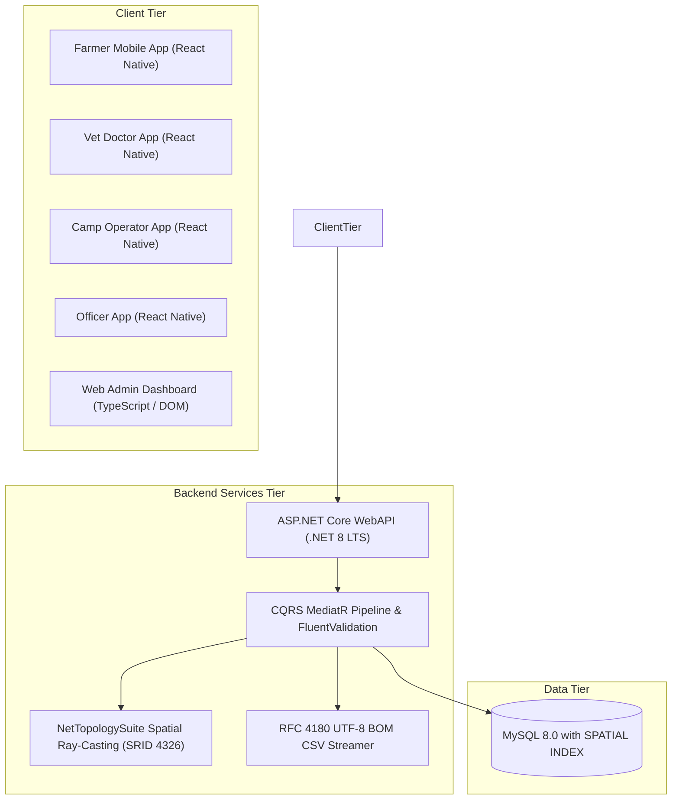

# Software Requirement Specification (SRS)
## Chara Chhavani Management System

---

### Document Control
- **Standard**: IEEE 830-1998 Recommended Practice for SRS
- **Version**: 1.0.0
- **Scope**: Multi-tier architecture encompassing 4 React Native Mobile Apps, ASP.NET Core WebAPI, MySQL 8.0 GIS, and Web Admin Dashboard.

---

## 1. Introduction

### 1.1 Purpose
This specification documents the functional and technical requirements for the **Chara Chhavani Management System**, defining the software architecture, data contracts, external interfaces, and compliance constraints.

### 1.2 System Scope
The system automates the lifecycle of government-sanctioned cattle relief camps across Maharashtra. It includes:
- Mobile applications for Farmers, Veterinary Doctors, Camp Operators, and Government Monitoring Officers.
- A centralized ASP.NET Core (.NET 8) WebAPI with NetTopologySuite for spatial calculations.
- MySQL 8.0 database engine storing spatial polygon geofences, cattle registries, and transaction ledgers.
- A browser-based administrative dashboard for state-level monitoring and statutory audit exports.

---

## 2. Overall Description

### 2.1 Product Perspective

### 2.2 User Classes and Characteristics
1. **Farmers**: Technical literacy varies; requires intuitive Marathi (मराठी) UI, large touch targets ($48\text{ dp}$), and SMS OTP authentication.
2. **Veterinary Officers**: Field mobility; requires quick photo capture, tag barcode scanning, and offline-tolerant draft storage.
3. **Camp Operators**: Heavy daily transaction entry (weighbridge receipts, feeding ledgers); requires clear error prompts and strict online admission gates.
4. **Monitoring Officers**: Random spot audits; requires rapid GPS stamping and automatic discrepancy alerts.
5. **State Administrators**: High-level data consumption; requires executive KPI cards, utilization progress bars, and Excel-ready CSV downloads.

---

## 3. External Interface Requirements

### 3.1 User Interfaces
- **Responsive Layout**: Fluid scaling from $320\text{ dp}$ budget phones to $10"$ tablets.
- **Typography**: Devanagari regional typography with explicit line-height ratio $\text{lineHeight} \ge 1.35 \times \text{fontSize}$.
- **Accessibility**: WCAG 2.1 AA compliant color contrast ratios ($4.5:1$ minimum).

### 3.2 Hardware Interfaces
- **GPS Receiver**: Location stamping with horizontal accuracy $\le 15\text{ meters}$.
- **Camera**: Resolution $\ge 2\text{ MP}$ for cattle muzzle/tag photos and inspection evidence.

### 3.3 Software Interfaces
- **Operating Systems**: Android 8.0+ / iOS 14.0+ for mobile; Modern Evergreen Browsers for Web Admin.
- **Database Engine**: MySQL Server 8.0+ with NetTopologySuite spatial extensions.
- **Authentication**: JWT Bearer tokens + 6-digit simulation/SMS OTP.
