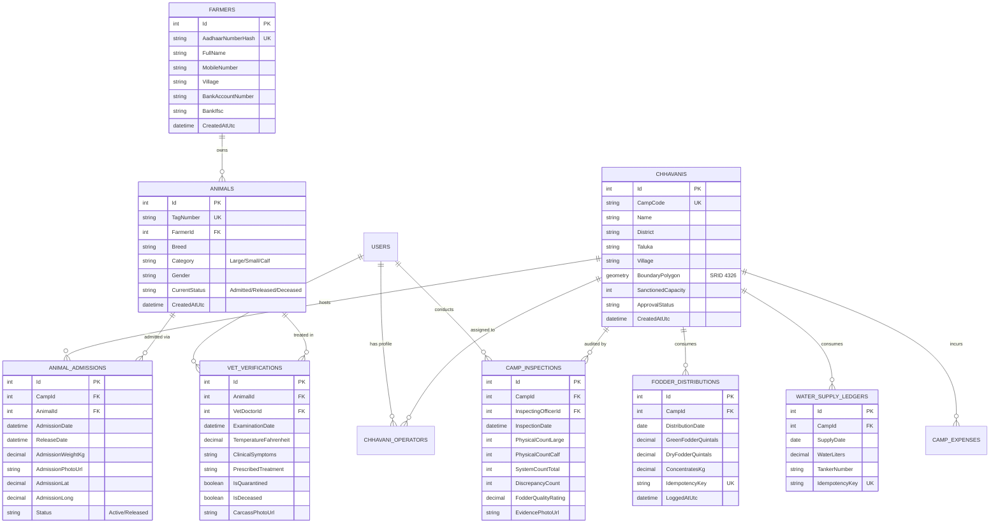

# Database Design & Entity Relationship (ER) Specification

**Project Name:** Chara Chhavani (Digital Cattle Camp Management System)  
**Database Engine:** MySQL 8.0 Community / Aurora MySQL  
**Character Set:** `utf8mb4` | **Collation:** `utf8mb4_unicode_ci`  
**Spatial Reference System:** SRID 4326 (WGS 84 Geodetic)  
**Document Version:** 1.0.0  
**Lead DBA & Architect:** Lead Solutions Architect  

---

## 1. Entity-Relationship (ER) Diagram



---

## 2. Table Schemas & Data Types

### 2.1 Table: `Chhavanis` (Cattle Camps)
Represents authorized cattle shelter locations with geospatial geofence boundaries.

| Column Name | Data Type | Nullable | Default | Description |
|---|---|---|---|---|
| `Id` | `INT AUTO_INCREMENT` | No | — | Primary Key |
| `CampCode` | `VARCHAR(32)` | No | — | Unique Camp Code (e.g., `CHH-PAITHAN-001`) |
| `Name` | `VARCHAR(128)` | No | — | Marathi/English Camp Name |
| `District` | `VARCHAR(64)` | No | — | District Name |
| `Taluka` | `VARCHAR(64)` | No | — | Taluka Name |
| `Village` | `VARCHAR(64)` | No | — | Village Name |
| `BoundaryPolygon` | `POLYGON SRID 4326` | No | — | Geofence boundary polygon (NetTopologySuite) |
| `CenterPoint` | `POINT SRID 4326` | No | — | Centroid of camp |
| `SanctionedCapacity` | `INT` | No | 500 | Max permitted cattle capacity |
| `CurrentOccupancy` | `INT` | No | 0 | Current live animal count |
| `ApprovalStatus` | `VARCHAR(20)` | No | `'Pending'` | `Pending`, `Approved`, `Suspended`, `Closed` |
| `CreatedAtUtc` | `DATETIME` | No | `CURRENT_TIMESTAMP` | Audit creation timestamp |

* **Indexes:**
  * `PRIMARY KEY (Id)`
  * `UNIQUE KEY UQ_Chhavanis_CampCode (CampCode)`
  * `SPATIAL INDEX SPX_Chhavanis_Boundary (BoundaryPolygon)`
  * `KEY IX_Chhavanis_District_Taluka (District, Taluka)`

---

### 2.2 Table: `Animals`
Master registry for all cattle brought to government relief camps.

| Column Name | Data Type | Nullable | Default | Description |
|---|---|---|---|---|
| `Id` | `INT AUTO_INCREMENT` | No | — | Primary Key |
| `TagNumber` | `VARCHAR(32)` | No | — | Unique RFID / Visual Barcode Ear Tag |
| `FarmerId` | `INT` | No | — | Foreign Key $\rightarrow$ `Farmers.Id` |
| `Breed` | `VARCHAR(64)` | No | — | Breed (e.g. Khillari, Deoni, Gir, Dangi) |
| `Category` | `VARCHAR(20)` | No | — | `Large` (>300kg), `Small` (150-300kg), `Calf` (<150kg) |
| `Gender` | `VARCHAR(10)` | No | — | `Male`, `Female` |
| `AgeMonths` | `INT` | Yes | NULL | Approximate age in months |
| `CurrentStatus` | `VARCHAR(20)` | No | `'Active'` | `Active`, `Released`, `Deceased` |
| `CreatedAtUtc` | `DATETIME` | No | `CURRENT_TIMESTAMP` | Creation timestamp |

* **Indexes:**
  * `PRIMARY KEY (Id)`
  * `UNIQUE KEY UQ_Animals_TagNumber (TagNumber)`
  * `KEY IX_Animals_FarmerId (FarmerId)`
  * `KEY IX_Animals_Status (CurrentStatus)`

---

### 2.3 Table: `AnimalAdmissions`
Tracks physical camp admission events with geofence stamp and live photo evidence.

| Column Name | Data Type | Nullable | Default | Description |
|---|---|---|---|---|
| `Id` | `INT AUTO_INCREMENT` | No | — | Primary Key |
| `CampId` | `INT` | No | — | Foreign Key $\rightarrow$ `Chhavanis.Id` |
| `AnimalId` | `INT` | No | — | Foreign Key $\rightarrow$ `Animals.Id` |
| `AdmissionDate` | `DATETIME` | No | — | Exact admission timestamp |
| `ReleaseDate` | `DATETIME` | Yes | NULL | Release timestamp |
| `AdmissionWeightKg` | `DECIMAL(6,2)` | No | — | Live cattle weight at gate |
| `AdmissionLat` | `DECIMAL(10,8)` | No | — | GPS Latitude captured at admission |
| `AdmissionLong` | `DECIMAL(11,8)` | No | — | GPS Longitude captured at admission |
| `AdmissionPhotoUrl`| `VARCHAR(255)` | No | — | Object store path to photo |
| `AdmittedByUserId`| `INT` | No | — | Foreign Key $\rightarrow$ `Users.Id` |
| `Status` | `VARCHAR(20)` | No | `'Admitted'` | `Admitted`, `Released` |

* **Indexes:**
  * `PRIMARY KEY (Id)`
  * `KEY IX_Admissions_Camp_Status (CampId, Status)`
  * `KEY IX_Admissions_AnimalId (AnimalId)`

---

### 2.4 Table: `FodderDistributions`
Daily feeding ledger normalized to $1\text{ Quintal} = 100\text{ Kg}$.

| Column Name | Data Type | Nullable | Default | Description |
|---|---|---|---|---|
| `Id` | `INT AUTO_INCREMENT` | No | — | Primary Key |
| `CampId` | `INT` | No | — | Foreign Key $\rightarrow$ `Chhavanis.Id` |
| `DistributionDate` | `DATE` | No | — | Date of feeding |
| `GreenFodderQuintals`| `DECIMAL(10,2)`| No | 0.00 | Metric normalized in Quintals |
| `DryFodderQuintals` | `DECIMAL(10,2)`| No | 0.00 | Metric normalized in Quintals |
| `ConcentratesKg` | `DECIMAL(10,2)`| No | 0.00 | Concentrates in Kilograms |
| `WaterLiters` | `DECIMAL(12,2)`| No | 0.00 | Water in Liters |
| `CattleCount` | `INT` | No | — | Total cattle fed on that date |
| `IdempotencyKey` | `VARCHAR(64)` | No | — | UUIDv4 from mobile sync |
| `LoggedAtUtc` | `DATETIME` | No | `CURRENT_TIMESTAMP` | Inward record timestamp |

* **Indexes:**
  * `PRIMARY KEY (Id)`
  * `UNIQUE KEY UQ_Fodder_Idempotency (IdempotencyKey)`
  * `KEY IX_Fodder_Camp_Date (CampId, DistributionDate)`

---

## 3. Spatial Queries & Geofencing SQL Execution

To verify whether an admission attempt at coordinate $(19.8214, 75.3341)$ lies within Paithan camp (#104):

```sql
SELECT 
    c.Id, 
    c.Name,
    ST_Contains(c.BoundaryPolygon, ST_SRID(POINT(75.3341, 19.8214), 4326)) AS IsInside,
    ST_Distance_Sphere(c.CenterPoint, POINT(75.3341, 19.8214)) AS DistanceFromCenterMeters
FROM Chhavanis c
WHERE c.Id = 104;
```
* If `IsInside = 1`, operation is permitted.
* If `IsInside = 0`, operation is blocked with `403 GeofenceViolationException`.
