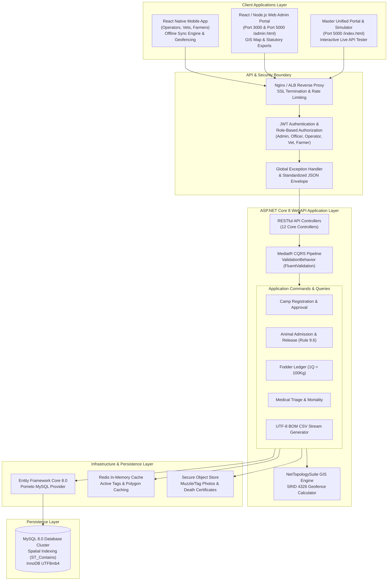
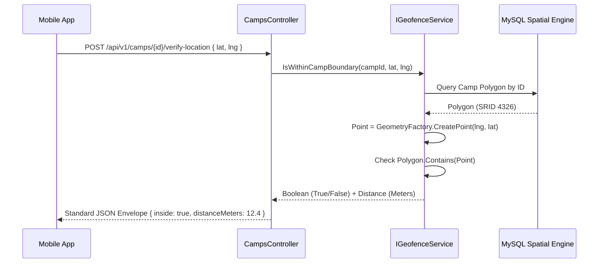
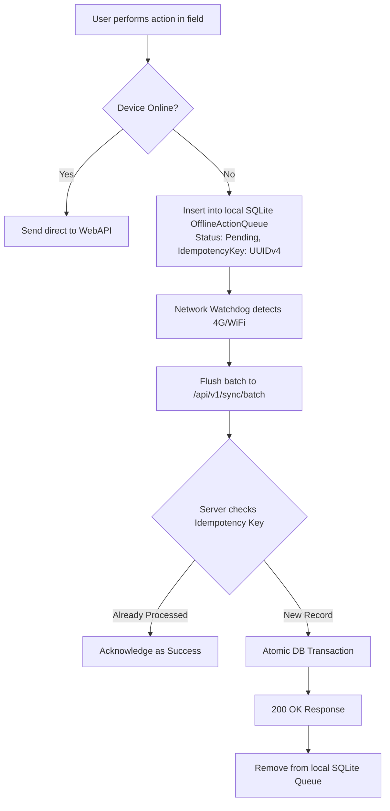

# High-Level Architecture Design Document (HLD)

**Project Name:** Chara Chhavani (Digital Cattle Camp Management System)  
**Document Version:** 1.0.0  
**Status:** Approved  
**Architecture Pattern:** Clean Architecture + CQRS + Event-Audited Ledger + Offline-First Sync  
**Lead Architect:** Principal Solutions Architect  

---

## 1. Architectural Goals & Non-Negotiable Invariants

1. **Rule 9.6 Anti-Fraud Enclosure:** Zero offline execution permitted for animal admissions or releases. Geofence polygon inclusion verified server-side with NetTopologySuite (SRID 4326).
2. **Unified Core Domain Model:** High cohesion, low coupling. Domain entities are isolated from persistence frameworks and transport contracts.
3. **Decoupled Read/Write Paths (CQRS):** Write operations execute via MediatR Commands with strict FluentValidation; Read queries execute optimized non-tracking queries.
4. **Statutory Devanagari Integrity:** All statutory CSV streams output RFC 4180 compliant formats prepended with UTF-8 BOM (`\uFEFF`) to prevent Excel character corruption.
5. **Multi-Platform Consistency:** Shared business logic and design tokens across React Native Mobile (`@chara-chhavani/ui-core`) and Web Admin (`apps/web-admin`).

---

## 2. High-Level System Architecture Diagram



---

## 3. Layered Clean Architecture Breakdown

The backend solution (`backend/CharaChhavani.sln`) is structured according to Clean Architecture boundaries:

```
CharaChhavani/
├── CharaChhavani.Domain/          # Core Domain Entities, Value Objects, Domain Events, Enums
├── CharaChhavani.Application/     # CQRS Commands/Queries, MediatR Handlers, Validators, DTOs, Interfaces
├── CharaChhavani.Infrastructure/  # EF Core DbContext, MySQL Configurations, GIS Services, Auth, File Store
└── CharaChhavani.WebApi/          # Controllers, Middlewares, Dependency Injection, Program.cs, wwwroot
```

### 3.1 Domain Layer (`CharaChhavani.Domain`)
* **Independence:** Zero external dependencies. Completely decoupled from database schemas, web frameworks, or third-party SDKs.
* **Core Entities:** `Chhavani` (Cattle Camp), `Animal`, `AnimalAdmission`, `ChhavaniOperator`, `Farmer`, `CampInspection`, `VetVerification`, `FodderDistribution`, `WaterSupplyLedger`.
* **Domain Invariants:**
  * Cattle Tag must be unique across all active camps.
  * Fodder measurements normalize strictly to $1\text{ Quintal} = 100\text{ Kg}$.
  * Animal status changes (`Admitted` $\rightarrow$ `Quarantined` $\rightarrow$ `Released` / `Deceased`) follow deterministic state machine rules.

### 3.2 Application Layer (`CharaChhavani.Application`)
* **MediatR Pipeline:** All business transactions execute via command handlers (e.g., `AdmitAnimalCommandHandler`, `RecordFeedingCommandHandler`).
* **Validation Pipeline:** Pre-processor pipeline behavior intercepts commands and executes FluentValidation rules before reaching the handler. If validation fails, `ValidationException` is thrown and converted to HTTP 400.
* **Result Wrapper Pattern:** All handlers return `Result<T>` or `Result`, ensuring structured error propagation without leaking unhandled exceptions.

### 3.3 Infrastructure Layer (`CharaChhavani.Infrastructure`)
* **ORM:** EF Core 8 with Pomelo.EntityFrameworkCore.MySql.
* **Spatial Processing:** `NetTopologySuite.Geometries.Polygon` and `Point` mapped to MySQL `POLYGON` and `POINT` spatial column types with spatial index:
  ```csharp
  builder.Entity<Chhavani>()
         .Property(c => c.BoundaryPolygon)
         .HasColumnType("polygon SRID 4326");
  ```
* **Configuration Hydration:** `EnvLoader.cs` reads `backend/.env` without overriding existing system properties or colliding with Windows host variables.

### 3.4 WebApi Presentation Layer (`CharaChhavani.WebApi`)
* **REST Endpoints:** 12 controllers mapped to standard routes (`api/v1/[controller]`).
* **Uniform API Response Envelope:** Handled by `HandleResult(result)`:
  ```json
  {
    "success": true,
    "message": "Animal admitted successfully",
    "data": { "animalId": 1042, "tagNumber": "MH-14-8841" },
    "errors": [],
    "traceId": "00-84a1e94...-01"
  }
  ```
* **Static Asset Hosting:** Serves the Master Unified Portal at `wwwroot/index.html` and administrative dashboard at `wwwroot/admin.html`.

---

## 4. Key Cross-Cutting Workflows

### 4.1 Geofence Calculation Workflow (GIS Service)
$$\text{PointInPolygon}(P, V) \iff \text{ST\_Contains}(BoundaryPolygon, Point(Lat, Long))$$



### 4.2 Offline Sync Queue Engine

For field operations eligible for offline logging (daily feeding, water logs, routine health checks):



---

## 5. Security & Governance Architecture

1. **Authentication:** Stateless Bearer JWT tokens signed with 256-bit secret key. Expiration = 8 hours.
2. **Authorization:** Role-Based Access Control (RBAC) enforced via `[Authorize(Roles = "...")]`.
3. **Data Protection:** Passwords hashed with BCrypt (Work Factor 11). Cattle photo assets stored in non-public buckets with time-limited signed URLs.
4. **Audit Trail:** Base entity `AuditableEntity` automatically tracks `CreatedAtUtc`, `CreatedBy`, `LastModifiedAtUtc`, `LastModifiedBy` across all mutations.
