# Low-Level Design Document (LLD)

**Project Name:** Chara Chhavani (Digital Cattle Camp Management System)  
**Document Version:** 1.0.0  
**Status:** Approved  
**Focus:** Detailed Class Design, Component Interactions, Data Structures & Pipelines  
**Lead Architect:** Principal Solutions Architect  

---

## 1. Class Design & Component Hierarchy

### 1.1 MediatR CQRS Pipeline & Handlers

The application layer strictly enforces the CQRS (Command Query Responsibility Segregation) pattern mediated by `MediatR`.

```mermaid
classDiagram
    class IRequest~TResponse~ {
        <<interface>>
    }
    class IRequestHandler~TRequest, TResponse~ {
        <<interface>>
        +Handle(request, cancellationToken) Task~TResponse~
    }
    class IPipelineBehavior~TRequest, TResponse~ {
        <<interface>>
        +Handle(request, next, cancellationToken) Task~TResponse~
    }
    
    class ValidationBehavior~TRequest, TResponse~ {
        -IEnumerable~IValidator~ _validators
        +Handle(request, next, cancellationToken)
    }
    class LoggingBehavior~TRequest, TResponse~ {
        -ILogger _logger
        +Handle(request, next, cancellationToken)
    }
    
    class AdmitAnimalCommand {
        +int CampId
        +string TagNumber
        +int FarmerId
        +CattleBreed Breed
        +CattleCategory Category
        +double Latitude
        +double Longitude
        +string PhotoBase64
    }
    class AdmitAnimalCommandHandler {
        -IApplicationDbContext _context
        -IGeofenceService _geofenceService
        -ICurrentUserService _currentUser
        +Handle(command, ct) Task~Result~int~~
    }
    
    class RecordFeedingCommand {
        +int CampId
        +DateTime DistributionDate
        +decimal GreenFodderQuintals
        +decimal DryFodderQuintals
        +decimal ConcentratesKg
        +decimal WaterLiters
        +string IdempotencyKey
    }
    class RecordFeedingCommandHandler {
        -IApplicationDbContext _context
        -IMetricConverter _converter
        +Handle(command, ct) Task~Result~int~~
    }
    
    IPipelineBehavior <|.. ValidationBehavior
    IPipelineBehavior <|.. LoggingBehavior
    IRequest <|.. AdmitAnimalCommand
    IRequest <|.. RecordFeedingCommand
    IRequestHandler <|.. AdmitAnimalCommandHandler
    IRequestHandler <|.. RecordFeedingCommandHandler
```



---

## 2. Validation & Pipeline Implementation

### 2.1 MediatR Pre-Processor: `ValidationBehavior<TRequest, TResponse>`
Before any command handler executes, the MediatR pipeline intercepts the request:

```csharp
public class ValidationBehavior<TRequest, TResponse> : IPipelineBehavior<TRequest, TResponse>
    where TRequest : IRequest<TResponse>
{
    private readonly IEnumerable<IValidator<TRequest>> _validators;

    public ValidationBehavior(IEnumerable<IValidator<TRequest>> validators)
    {
        _validators = validators;
    }

    public async Task<TResponse> Handle(
        TRequest request, 
        RequestHandlerDelegate<TResponse> next, 
        CancellationToken cancellationToken)
    {
        if (_validators.Any())
        {
            var context = new ValidationContext<TRequest>(request);
            var validationResults = await Task.WhenAll(
                _validators.Select(v => v.ValidateAsync(context, cancellationToken)));
            
            var failures = validationResults
                .SelectMany(r => r.Errors)
                .Where(f => f != null)
                .ToList();

            if (failures.Count != 0)
                throw new FluentValidation.ValidationException(failures);
        }

        return await next();
    }
}
```

### 2.2 FluentValidation Rules: `AdmitAnimalCommandValidator`
```csharp
public class AdmitAnimalCommandValidator : AbstractValidator<AdmitAnimalCommand>
{
    public AdmitAnimalCommandValidator()
    {
        RuleFor(x => x.CampId).GreaterThan(0).WithMessage("Camp ID must be valid.");
        RuleFor(x => x.TagNumber)
            .NotEmpty().WithMessage("Tag number is mandatory.")
            .Matches(@"^[A-Z0-9-]{6,16}$").WithMessage("Invalid tag number format.");
        RuleFor(x => x.Latitude).InclusiveBetween(-90.0, 90.0);
        RuleFor(x => x.Longitude).InclusiveBetween(-180.0, 180.0);
        RuleFor(x => x.PhotoBase64).NotEmpty().WithMessage("Live photo capture is required.");
    }
}
```

---

## 3. Global Exception Handling & Standard Response Envelope

All API requests pass through `ExceptionHandlingMiddleware`, guaranteeing zero leaked stack traces in production:

```csharp
public class ExceptionHandlingMiddleware
{
    private readonly RequestDelegate _next;
    private readonly ILogger<ExceptionHandlingMiddleware> _logger;

    public ExceptionHandlingMiddleware(RequestDelegate next, ILogger<ExceptionHandlingMiddleware> logger)
    {
        _next = next;
        _logger = logger;
    }

    public async Task InvokeAsync(HttpContext context)
    {
        try
        {
            await _next(context);
        }
        catch (FluentValidation.ValidationException valEx)
        {
            context.Response.ContentType = "application/json";
            context.Response.StatusCode = (int)HttpStatusCode.BadRequest;
            
            var errors = valEx.Errors.Select(e => e.ErrorMessage).ToList();
            var response = ApiResponse<object>.Failure("Validation failed", errors, context.TraceIdentifier);
            await context.Response.WriteAsync(JsonSerializer.Serialize(response));
        }
        catch (GeofenceViolationException geoEx)
        {
            context.Response.ContentType = "application/json";
            context.Response.StatusCode = (int)HttpStatusCode.Forbidden;
            var response = ApiResponse<object>.Failure(geoEx.Message, new List<string> { geoEx.Message }, context.TraceIdentifier);
            await context.Response.WriteAsync(JsonSerializer.Serialize(response));
        }
        catch (Exception ex)
        {
            _logger.LogError(ex, "Unhandled server error trace {TraceId}", context.TraceIdentifier);
            context.Response.ContentType = "application/json";
            context.Response.StatusCode = (int)HttpStatusCode.InternalServerError;
            var response = ApiResponse<object>.Failure("An internal error occurred.", new List<string> { ex.Message }, context.TraceIdentifier);
            await context.Response.WriteAsync(JsonSerializer.Serialize(response));
        }
    }
}
```

---

## 4. Mobile Client Architecture (`packages/ui-core`)

### 4.1 `SessionManager` Implementation
Manages user authentication state, secure JWT token persistence, and role-based permissions:

```typescript
export class SessionManager {
  private static instance: SessionManager;
  private currentToken: string | null = null;
  private currentUser: UserProfile | null = null;

  private constructor() {}

  public static getInstance(): SessionManager {
    if (!SessionManager.instance) {
      SessionManager.instance = new SessionManager();
    }
    return SessionManager.instance;
  }

  public async setSession(token: string, user: UserProfile): Promise<void> {
    this.currentToken = token;
    this.currentUser = user;
    await SecureStorage.setItem('jwt_token', token);
    await Storage.setItem('user_profile', JSON.stringify(user));
  }

  public isAuthorized(allowedRoles: string[]): boolean {
    if (!this.currentUser) return false;
    return allowedRoles.includes(this.currentUser.role);
  }

  public async clearSession(): Promise<void> {
    this.currentToken = null;
    this.currentUser = null;
    await SecureStorage.removeItem('jwt_token');
    await Storage.removeItem('user_profile');
  }
}
```

### 4.2 `OfflineActionQueue` Implementation
Enforces Rule 9.6 while queueing permitted daily feeding and vet records:

```typescript
export interface QueuedAction {
  id: string; // UUID v4 idempotency key
  actionType: 'FEEDING_LOG' | 'WATER_LOG' | 'VET_CHECK';
  campId: number;
  payload: Record<string, any>;
  timestamp: string;
  retryCount: number;
}

export class OfflineActionQueue {
  private static FORBIDDEN_OFFLINE_ACTIONS = ['ADMISSION', 'RELEASE'];

  public static async enqueue(action: QueuedAction): Promise<boolean> {
    if (this.FORBIDDEN_OFFLINE_ACTIONS.includes(action.actionType)) {
      throw new Error("Rule 9.6 Violation: Admission and Release are strictly online operations.");
    }
    const queue = await this.getQueue();
    queue.push(action);
    await Storage.setItem('offline_action_queue', JSON.stringify(queue));
    return true;
  }

  public static async flush(apiClient: ApiClient): Promise<{ succeeded: number; failed: number }> {
    const queue = await this.getQueue();
    const remaining: QueuedAction[] = [];
    let succeeded = 0;

    for (const item of queue) {
      try {
        await apiClient.sync.postBatchItem(item);
        succeeded++;
      } catch (err) {
        item.retryCount++;
        remaining.push(item);
      }
    }

    await Storage.setItem('offline_action_queue', JSON.stringify(remaining));
    return { succeeded, failed: remaining.length };
  }
}
```

---

## 5. Dependency Injection & Service Registration Graph

Configured in `CharaChhavani.WebApi/Program.cs`:

```csharp
// Infrastructure & Database
builder.Services.AddDbContext<ApplicationDbContext>(options =>
    options.UseMySql(connectionString, ServerVersion.AutoDetect(connectionString),
        x => x.UseNetTopologySuite()));

// Scoped Domain Services
builder.Services.AddScoped<IApplicationDbContext>(sp => sp.GetRequiredService<ApplicationDbContext>());
builder.Services.AddScoped<IGeofenceService, GeofenceService>();
builder.Services.AddScoped<ICsvExportService, CsvExportService>();
builder.Services.AddScoped<ITokenProvider, JwtTokenProvider>();

// MediatR & Pipeline Behaviors
builder.Services.AddMediatR(cfg => {
    cfg.RegisterServicesFromAssembly(typeof(AdmitAnimalCommandHandler).Assembly);
    cfg.AddBehavior(typeof(IPipelineBehavior<,>), typeof(LoggingBehavior<,>));
    cfg.AddBehavior(typeof(IPipelineBehavior<,>), typeof(ValidationBehavior<,>));
});

// FluentValidation
builder.Services.AddValidatorsFromAssembly(typeof(AdmitAnimalCommandValidator).Assembly);
```
