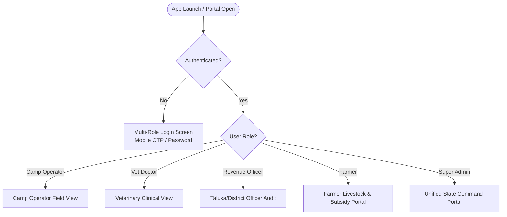
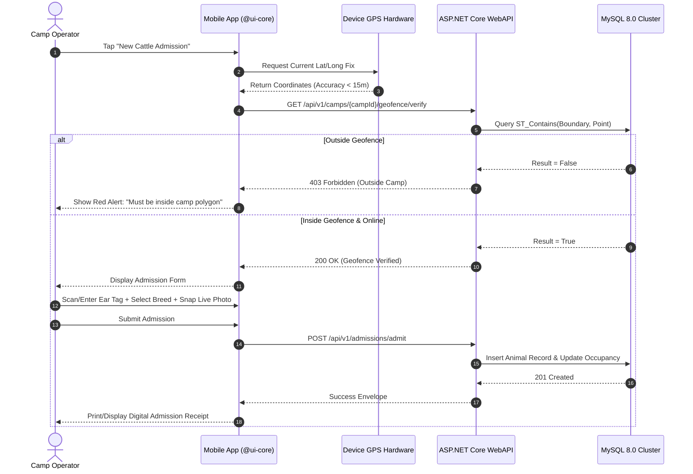
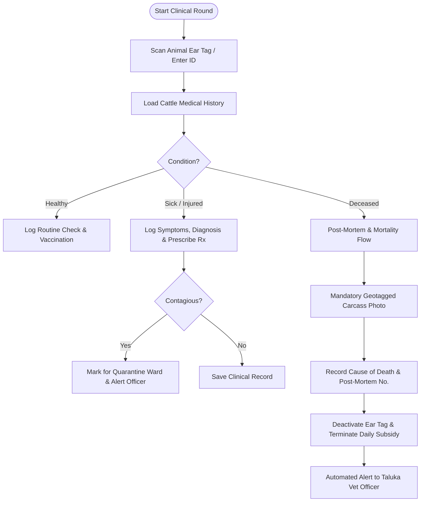

# Wireframes & User Flows

**Project Name:** Chara Chhavani (Digital Cattle Camp Management System)  
**Document Version:** 1.0.0  
**Status:** Approved  
**Coverage:** 5 Key User Personas (Farmer, Camp Operator, Vet Doctor, District Officer, Super Admin)  

---

## 1. Overall System Navigation Architecture



---

## 2. Persona 1: Camp Operator User Flow & Wireframes

### 2.1 Workflow: Animal Admission (Online & Geofenced - Rule 9.6)



### 2.2 Wireframe: Camp Operator Mobile Dashboard

```
+-------------------------------------------------------------+
| [=] Chara Chhavani (पैलठण छावणी - ID: #104)      [Offline: 0] |
+-------------------------------------------------------------+
| GEOFENCE STATUS: [● INSIDE CAMP] (Accuracy: 8m)             |
+-------------------------------------------------------------+
| SUMMARY METRICS                                             |
|  +--------------------+  +--------------------+             |
|  | Total Cattle: 842  |  | Today Admitted: 14 |             |
|  | Large: 710 Calf:132|  | Released: 2        |             |
|  +--------------------+  +--------------------+             |
|  | Today Green Fodder |  | Water Consumed     |             |
|  | 126.3 Quintals     |  | 28,400 Liters      |             |
|  +--------------------+  +--------------------+             |
+-------------------------------------------------------------+
| PRIMARY ACTIONS                                             |
|  [ + Admit Cattle (प्रवेश) ]       [ - Release Cattle (सुटका) ]|
|  [ Daily Fodder Distribution ]    [ Inward Stock Receipt ]   |
|  [ View Registered Herd ]         [ Sync Offline Queue (0) ] |
+-------------------------------------------------------------+
| RECENT ACTIVITY                                             |
| • 09:15 AM - Tag #MH-14-9921 Admitted (Cow / Desi)          |
| • 08:45 AM - Fodder Truck Inward: 120 Quintals Sugarcane    |
| • 07:30 AM - Morning Batch Feeding Synchronized             |
+-------------------------------------------------------------+
```

---

## 3. Persona 2: Veterinary Doctor User Flow & Wireframes

### 3.1 Workflow: Daily Health Check & Mortality Triage



### 3.2 Wireframe: Veterinary Clinical Inspection Screen

```
+-------------------------------------------------------------+
| [< Back] Veterinary Examination (पशुवैद्यकीय तपासणी)       |
+-------------------------------------------------------------+
| ANIMAL ID: MH-20-4491     BREED: Khillari (खिल्लार)         |
| AGE: 4 Yrs | GENDER: Female | OWNER: Tukaram Shinde         |
+-------------------------------------------------------------+
| CURRENT CLINICAL OBSERVATION                                |
| Temperature (°F): [ 102.4 ]    Pulse Rate: [ 68 ]           |
| Body Weight (Kg): [ 385   ]    Respiratory: Normal          |
+-------------------------------------------------------------+
| DIAGNOSIS / SYMPTOMS                                        |
| [X] Foot and Mouth Disease Suspected                        |
| [ ] Lumpy Skin Lesions                                      |
| [ ] Digestive Colic / Bloat                                 |
| [ ] Dehydration / Heatstroke                                |
+-------------------------------------------------------------+
| ACTION & PRESCRIPTION                                       |
| [X] Move to Camp Isolation Ward                             |
| Medication Administered:                                    |
| [ Enrofloxacin 10ml IM, Meloxicam 15ml IM                 ] |
+-------------------------------------------------------------+
| [ ATTACH CLINICAL PHOTO ]  (1 Photo Attached)               |
+-------------------------------------------------------------+
| [ SUBMIT CLINICAL RECORD ]                                  |
+-------------------------------------------------------------+
```

---

## 4. Persona 3: Revenue & Inspection Officer User Flow

### 4.1 Workflow: Surprise Inspection & Physical Headcount

```mermaid
flowchart LR
    Arrival([Officer Arrives at Camp]) --> GeofenceLock[GPS Geofence Verified]
    GeofenceLock --> StartInspection[Initiate Inspection Session]
    StartInspection --> SampleCheck[Random Physical Ear-Tag Headcount]
    SampleCheck --> CompareTally[System Compares Physical vs Registered Count]
    CompareTally --> LogDiscrepancy[Log Shortfall / Discrepancy %]
    LogDiscrepancy --> SignInspection[Officer Digital Signature & Geotagged Photo]
    SignInspection --> PenaltyTrigger[Automatic Calculation of Subsidy Penalty]
```



### 4.2 Wireframe: Officer Surprise Inspection View

```
+-------------------------------------------------------------+
| OFFICER AUDIT PORTAL: Chhavani #104 (Paithan, Chh. Sambh.)  |
+-------------------------------------------------------------+
| REGISTERED CAMP OCCUPANCY:                                  |
| Large Cattle: 710 | Calves: 132 | Total System Count: 842   |
+-------------------------------------------------------------+
| PHYSICAL ON-GROUND TALLY:                                   |
| Physical Large Count: [ 698 ]   Physical Calf Count: [ 130 ]|
| Total Physical Count: 828                                   |
| Shortfall Detected: -14 Cattle (1.66% Discrepancy)          |
+-------------------------------------------------------------+
| QUALITY EVALUATION (1-5 Stars):                             |
| Fodder Quality:   [★★★★☆]  (Good green maize, adequate dry) |
| Water Cleanliness: [★★★★★]  (Continuous supply, clean tanks)|
| Hygiene & Sheds:  [★★★☆☆]  (Dung clearance delayed)        |
+-------------------------------------------------------------+
| EVIDENCE CAPTURE:                                           |
| [ CAMERA: SNAP INSPECTION EVIDENCE PHOTO (Geotagged) ]      |
+-------------------------------------------------------------+
| REMARKS:                                                    |
| [ 14 cattle missing during morning muster. Operator warned. ]|
+-------------------------------------------------------------+
| [ REJECT & SUSPEND CAMP ]        [ APPROVE AUDIT WITH DEDUCTION ]|
+-------------------------------------------------------------+
```

---

## 5. Persona 4: Super Admin & Unified State Command Center

### 5.1 Wireframe: Web Admin Dashboard (`apps/web-admin`)

```
+----------------------------------------------------------------------------------------------------------------------+
| CHARA CHHAVANI - STATE COMMAND PORTAL (महाराष्ट्र शासन)                           [Live: 2026-11-22]  [Admin: Logout]|
+----------------------------------------------------------------------------------------------------------------------+
| [Dashboard]   [Camp Approvals]   [Live GIS Map]   [Audit Logs]   [Subsidy Treasury Disbursal]   [Statutory Exports]  |
+----------------------------------------------------------------------------------------------------------------------+
| STATEWIDE DRILLDOWN METRICS                                                                                          |
| +---------------------+ +---------------------+ +---------------------+ +---------------------+                     |
| | Active Camps: 48    | | Cattle Sheltered:   | | Fodder Distributed: | | Subsidy Accrued:    |                     |
| | 8 Districts         | | 42,850 Head         | | 6,427.5 Quintals/day| | ₹ 47,13,500 / day   |                     |
| +---------------------+ +---------------------+ +---------------------+ +---------------------+                     |
+----------------------------------------------------------------------------------------------------------------------+
| GIS CAMP DISTRIBUTION & COMPLIANCE                                                                                   |
|  [======================================== MAP ========================================]                              |
|  |  Chhatrapati Sambhajinagar: 18 Camps (Green: 17, Yellow: 1)                         |                              |
|  |  Beed: 14 Camps (Green: 12, Yellow: 2)                                              |                              |
|  |  Dharashiv: 10 Camps (Green: 9, Red: 1 - Alert: Discrepancy > 5%)                  |                              |
|  |  Jalna: 6 Camps (Green: 6)                                                          |                              |
|  [=====================================================================================]                              |
+----------------------------------------------------------------------------------------------------------------------+
| STATUTORY EXPORTS (WITH UTF-8 BOM FOR MS EXCEL COMPATIBILITY):                                                       |
| [ Download Feeding CSV (खाद्य अहवाल) ]         [ Download Inspection CSV (तपासणी अहवाल) ]                            |
| [ Download Attendance CSV (उपस्थिती अहवाल) ]   [ Download Disbursal Reconciliation CSV (अनुदान अहवाल) ]              |
+----------------------------------------------------------------------------------------------------------------------+
```
