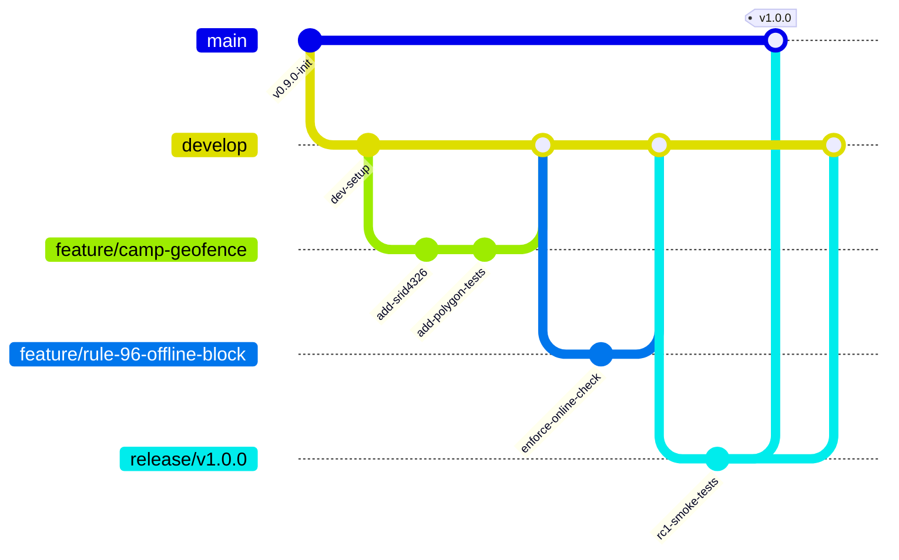

# Repository & Branching Strategy

**Project Name:** Chara Chhavani (Digital Cattle Camp Management System)  
**Document Version:** 1.0.0  
**Status:** Approved  
**VCS Provider:** Git / GitHub Enterprise  
**Branching Model:** Scaled Trunk-Based Development with Release Gates  

---

## 1. Branching Strategy & Lifecycle

---

## 2. Branch Nomenclature & Rules

| Branch Type | Naming Convention | Source Branch | Merge Target | Rules & Policies |
|---|---|---|---|---|
| **Production** | `main` | `release/*` or `hotfix/*` | None | Protected. Direct push prohibited. Requires 2 peer reviews + 100% passing CI suite. |
| **Integration** | `develop` | `main` | `release/*` | Active integration branch. All feature branches merge here via PR. |
| **Feature** | `feature/<jira-id>-<short-slug>` | `develop` | `develop` | Short-lived ($< 3\text{ days}$). Squash-merged upon approval. |
| **Bugfix** | `bugfix/<jira-id>-<short-slug>` | `develop` | `develop` | Resolves defects found during QA/staging testing. |
| **Release** | `release/v<major>.<minor>.<patch>`| `develop` | `main` & `develop` | Feature freeze. Only critical release stabilization fixes permitted. |
| **Hotfix** | `hotfix/<incident-id>-<slug>` | `main` | `main` & `develop` | Emergency production patches. Immediately tagged and deployed. |

---

## 3. Pull Request (PR) Requirements & Gates

Every Pull Request submitted to `develop` or `main` must fulfill the following automated gates before merge eligibility:

1. **Compilation & Build:** `dotnet build -c Release` and `npm run build` must complete with zero errors and zero warnings.
2. **Automated Unit & Integration Tests:** 100% pass rate on the 67 backend tests (`dotnet test -c Release`) and Node.js mobile test suite (`session-offline-test.mjs`).
3. **E2E Smoke Tests:** Automated smoke test suite (`scripts/e2e_smoke_test.ps1`) executing all 19 functional checks against local test instance.
4. **Code Coverage:** Minimum 85% branch coverage on newly introduced domain and application logic.
5. **Static Analysis & Security:** Zero SonarQube blocker/critical vulnerabilities and zero npm/NuGet high-severity CVEs.
6. **Peer Approval:** Minimum 2 Senior Approvals (1 Architecture Lead + 1 QA Automation Lead).

---

## 4. Release Tagging & Semantic Versioning

The project adheres to Semantic Versioning (`vMAJOR.MINOR.PATCH`):
* **MAJOR (1.0.0):** Architectural overhauls or incompatible statutory GR rule changes.
* **MINOR (1.1.0):** New functional capabilities (e.g., adding drone survey integration, new taluka modules).
* **PATCH (1.0.1):** Bug fixes, performance optimizations, or UI text adjustments.

All tags pushed to `main` trigger automated GitHub Actions/GitLab CI deployment pipelines targeting staging and production container registries.
