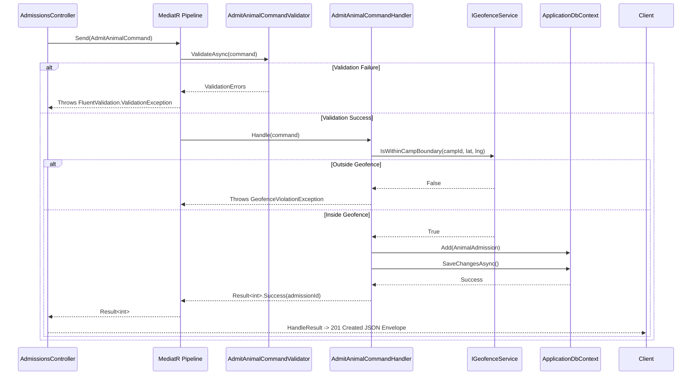

# Technical Design Document (TDD)

**Project Name:** Chara Chhavani (Digital Cattle Camp Management System)  
**Document Version:** 1.0.0  
**Status:** Approved  
**Frameworks:** ASP.NET Core 8.0 (.NET 8 C#), React Native / Expo, TypeScript 5.x, Node.js 20+  
**Lead Architect:** Principal Solutions Architect  

---

## 1. Technical Stack Overview

| Tier | Technology | Key Libraries / Packages | Purpose |
|---|---|---|---|
| **Backend API** | ASP.NET Core 8.0 | MediatR, FluentValidation, BCrypt.Net, NetTopologySuite | RESTful WebAPI, CQRS execution, GIS geofencing |
| **ORM & Persistence** | EF Core 8.0 | `Pomelo.EntityFrameworkCore.MySql`, `NetTopologySuite.IO.MySqlConnector` | MySQL 8.0 spatial polygon querying, migration engine |
| **Mobile Client** | React Native (Expo) | `@react-native-async-storage`, `react-native-svg`, `expo-location` | Field mobile application for Operators and Vets |
| **Shared UI & Client** | TypeScript Monorepo | `@chara-chhavani/ui-core`, `@chara-chhavani/api-client` | Design tokens, responsive components, typed API SDK |
| **Web Admin Portal** | Node.js / React | `express`, `leaflet` / GIS map engine, `chart.js` | District/Taluka oversight, live monitoring, audit |
| **Database** | MySQL 8.0 Community | InnoDB, Spatial Indexing (SRID 4326), `utf8mb4` | Primary transactional relational & spatial database |

---

## 2. Backend Design: ASP.NET Core 8 Clean Architecture

### 2.1 Solution Structure & Project References

```
backend/CharaChhavani.sln
│
├── src/CharaChhavani.Domain
│   └── (Zero dependencies - Pure POCO entities & enums)
│
├── src/CharaChhavani.Application
│   └── (Depends on Domain; references MediatR, FluentValidation)
│
├── src/CharaChhavani.Infrastructure
│   └── (Depends on Application & Domain; references Pomelo EF Core, NetTopologySuite, BCrypt)
│
└── src/CharaChhavani.WebApi
    └── (Depends on Application & Infrastructure; hosts endpoints, middlewares, wwwroot)
```

### 2.2 MediatR CQRS Execution Flow



### 2.3 Spatial Geofence Query Execution
Geospatial boundaries are processed using NetTopologySuite geometries mapped to MySQL spatial columns:

```csharp
public async Task<bool> IsWithinCampBoundary(int campId, double latitude, double longitude, CancellationToken ct)
{
    var camp = await _context.Chhavanis
        .AsNoTracking()
        .Select(c => new { c.Id, c.BoundaryPolygon })
        .FirstOrDefaultAsync(c => c.Id == campId, ct);

    if (camp == null || camp.BoundaryPolygon == null)
        return false;

    // Coordinate order: Longitude (X), Latitude (Y) in WGS 84 SRID 4326
    var point = _geometryFactory.CreatePoint(new Coordinate(longitude, latitude));
    return camp.BoundaryPolygon.Contains(point);
}
```

---

## 3. Mobile Client Design (`packages/ui-core` & `api-client`)

### 3.1 Architecture Overview
The client is structured as an offline-first architecture with strict anti-fraud policy enforcement:

```
[UI Layer: ScreenContainer & Responsive Components]
                       │
                       ▼
             [SessionManager]
          (Token & Role Check)
                       │
                       ▼
             [OfflineActionQueue]
    ┌──────────────────┴──────────────────┐
    ▼ (Admission / Release)               ▼ (Feeding / Vet Log)
[Rule 9.6 Online Check]             [Network Watchdog]
If Offline -> BLOCK ACTION          If Online  -> Send API Direct
If Online  -> Verify GPS & Send     If Offline -> Enqueue SQLite
```

### 3.2 Responsive Scaling Math
To prevent layout degradation on budget Android devices:
$$\text{scale}(size) = \frac{\text{width}}{375} \times size$$
$$\text{verticalScale}(size) = \frac{\text{height}}{812} \times size$$
$$\text{moderateScale}(size, factor = 0.5) = size + (\text{scale}(size) - size) \times factor$$

---

## 4. Statutory CSV Export Engine with UTF-8 BOM

To ensure complete interoperability with government Windows workstations running Microsoft Excel:

```csharp
public async Task<byte[]> GenerateFeedingCsvAsync(int campId, CancellationToken ct)
{
    var records = await _context.FodderDistributions
        .Where(f => f.CampId == campId)
        .OrderByDescending(f => f.DistributionDate)
        .ToListAsync(ct);

    var builder = new StringBuilder();
    // Prepend UTF-8 Byte Order Mark (0xEF, 0xBB, 0xBF)
    builder.Append('\uFEFF');
    builder.AppendLine("तारीख,छावणी कोड,हिरवा चारा (क्विंटल),सुका चारा (क्विंटल),खाद्य पेंड (किलो),पाणी (लिटर)");

    foreach (var r in records)
    {
        builder.AppendLine($"{r.DistributionDate:yyyy-MM-dd},{r.CampId},{r.GreenFodderQuintals:F2},{r.DryFodderQuintals:F2},{r.ConcentratesKg:F2},{r.WaterLiters:F2}");
    }

    return Encoding.UTF8.GetBytes(builder.ToString());
}
```
