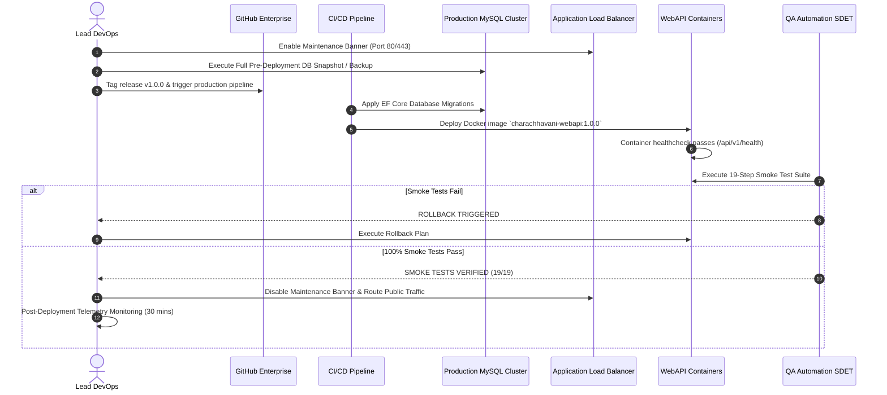

# Production Deployment Plan

**Project Name:** Chara Chhavani (Digital Cattle Camp Management System)  
**Document Version:** 1.0.0  
**Status:** Approved  
**Deployment Window:** Sunday, 02:00 AM – 04:30 AM IST  
**Environment:** Production (MeghRaj NIC Cloud / AWS AP-South-1)  

---

## 1. Deployment Team & Contact Roster

| Role | Name | Phone / Signal | Escalation Level |
|---|---|---|---|
| **Incident Commander** | Lead Delivery Manager | +91-98XXXXXXXX | Level 1 (Overall Lead) |
| **Lead DevOps Engineer** | Cloud Infrastructure Lead | +91-98XXXXXXXX | Level 1 (Executes Pipeline) |
| **Lead Database Administrator** | Principal DBA | +91-98XXXXXXXX | Level 1 (DB Migrations) |
| **Principal Solutions Architect**| Software Architect | +91-98XXXXXXXX | Level 2 (Architecture / Bugs) |
| **QA Automation Lead** | SDET Lead | +91-98XXXXXXXX | Level 2 (Smoke Test Sign-Off) |

---

## 2. Step-by-Step Deployment Execution Runbook

---

## 3. Granular Step Timing & Execution Details

| Time (IST) | Action | Command / Procedure | Validation |
|---|---|---|---|
| **02:00 AM** | Maintenance Mode | Route traffic to static `maintenance.html` on ALB. | Verify public URL shows maintenance notice. |
| **02:10 AM** | Database Snapshot | `mysqldump -u root -p charachhavanidb > pre_v100_snapshot.sql` | Confirm backup file integrity and non-zero size. |
| **02:25 AM** | Schema Migration | `dotnet ef database update --project backend/src/CharaChhavani.Infrastructure` | Verify zero migration errors; schema version updated. |
| **02:40 AM** | Container Deployment | Pull and start container images via Docker Compose / ECS task update. | Verify containers report `healthy` in `docker ps`. |
| **02:55 AM** | Health Probe | `curl -f http://localhost:8080/api/v1/health` | Returns HTTP `200 OK`. |
| **03:05 AM** | Automated Smoke Tests | `.\scripts\e2e_smoke_test.ps1 -ApiBaseUrl "http://localhost:8080"` | All 19 tests return `[PASS]`. |
| **03:30 AM** | Traffic Switchover | Remove ALB maintenance routing; enable live backend target group. | Public portal loads live. |
| **03:45 AM** | Live Field Verification | Field operator in Paithan executes test location verification. | Verification succeeds. |
| **04:15 AM** | Sign-Off | Send deployment completion notice to State Command Center. | Formal release closed. |
