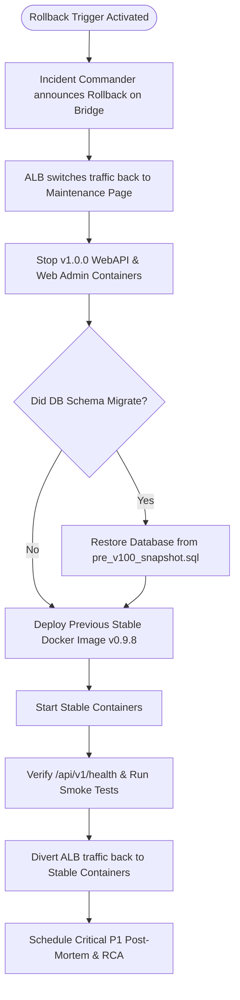

# Production Rollback Plan

**Project Name:** Chara Chhavani (Digital Cattle Camp Management System)  
**Document Version:** 1.0.0  
**Status:** Approved  
**Classification:** Confidential - Disaster Recovery & Incident Protocol  
**Authorized By:** Principal Solutions Architect & Incident Commander  

---

## 1. Rollback Criteria & Triggers

A formal rollback decision must be called by the Incident Commander if any of the following conditions occur during the deployment window ($02:00\text{ AM} - 04:30\text{ AM IST}$):

1. **Smoke Test Failure:** Any failure in the 19 critical E2E smoke tests that cannot be hotfixed within 15 minutes.
2. **Database Migration Failure:** A fatal error during EF Core schema migration or corrupt spatial index generation on MySQL 8.0.
3. **Elevated Error Rates:** Post-switchover API error rate exceeds $> 1\%$ (HTTP 500 status codes) for 5 consecutive minutes.
4. **Data Corruption:** Erroneous calculation or corruption of cattle headcount ledgers or subsidy financial records.
5. **Geofence Engine Failure:** NetTopologySuite throws unhandled geometric exceptions on valid SRID 4326 polygon queries.

---

## 2. Rollback Execution Workflow



---

## 3. Step-by-Step Rollback Runbook

### Step 1: Immediate Traffic Isolation (Elapsed Time: 1 Minute)
Route all public traffic to the static maintenance page at the ALB level:
```bash
aws elbv2 modify-listener --listener-arn <ALB_LISTENER_ARN> \
  --default-actions Type=forward,TargetGroupArn=<MAINTENANCE_TARGET_GROUP_ARN>
```

### Step 2: Stop Degraded Services (Elapsed Time: 3 Minutes)
Halt all running v1.0.0 containers to prevent further database mutations:
```bash
docker-compose -f docker-compose.prod.yml down
```

### Step 3: Database Snapshot Restoration (Elapsed Time: 12 Minutes)
If the database migration altered tables or corrupted schemas, restore the pre-deployment snapshot:
```bash
# Drop current corrupted database
mysql -u root -p -e "DROP DATABASE charachhavanidb; CREATE DATABASE charachhavanidb CHARACTER SET utf8mb4 COLLATE utf8mb4_unicode_ci;"

# Restore pre-deployment cold backup
mysql -u root -p charachhavanidb < /var/backups/chara/pre_v100_snapshot.sql

# Verify spatial indexes and record count integrity
mysql -u root -p charachhavanidb -e "SELECT COUNT(*) FROM Chhavanis; SHOW INDEX FROM Chhavanis WHERE Key_name = 'SPX_Chhavanis_Boundary';"
```

### Step 4: Re-Deploy Previous Stable Release (Elapsed Time: 5 Minutes)
Revert the container image tag to the last certified build (`v0.9.8`):
```bash
export IMAGE_TAG=v0.9.8
docker-compose -f docker-compose.prod.yml up -d
```

### Step 5: Verification & Traffic Re-Enabling (Elapsed Time: 5 Minutes)
1. Probe health endpoint: `curl -f http://localhost:8080/api/v1/health`
2. Run smoke tests: `.\scripts\e2e_smoke_test.ps1 -ApiBaseUrl "http://localhost:8080"`
3. Re-enable live traffic at ALB:
   ```bash
   aws elbv2 modify-listener --listener-arn <ALB_LISTENER_ARN> \
     --default-actions Type=forward,TargetGroupArn=<LIVE_TARGET_GROUP_ARN>
   ```

---

## 4. Post-Rollback Protocol

1. Send notification broadcast to District Collectors informing them of postponed rollout.
2. Preserve all container crash logs, MySQL error logs, and Serilog telemetry traces to `docs/logs/`.
3. Convene an emergency RCA (Root Cause Analysis) meeting within 8 hours.
4. Create an entry in `docs/logs/rca_capa_log.md` detailing root cause, 5-whys, and preventive safeguards.
