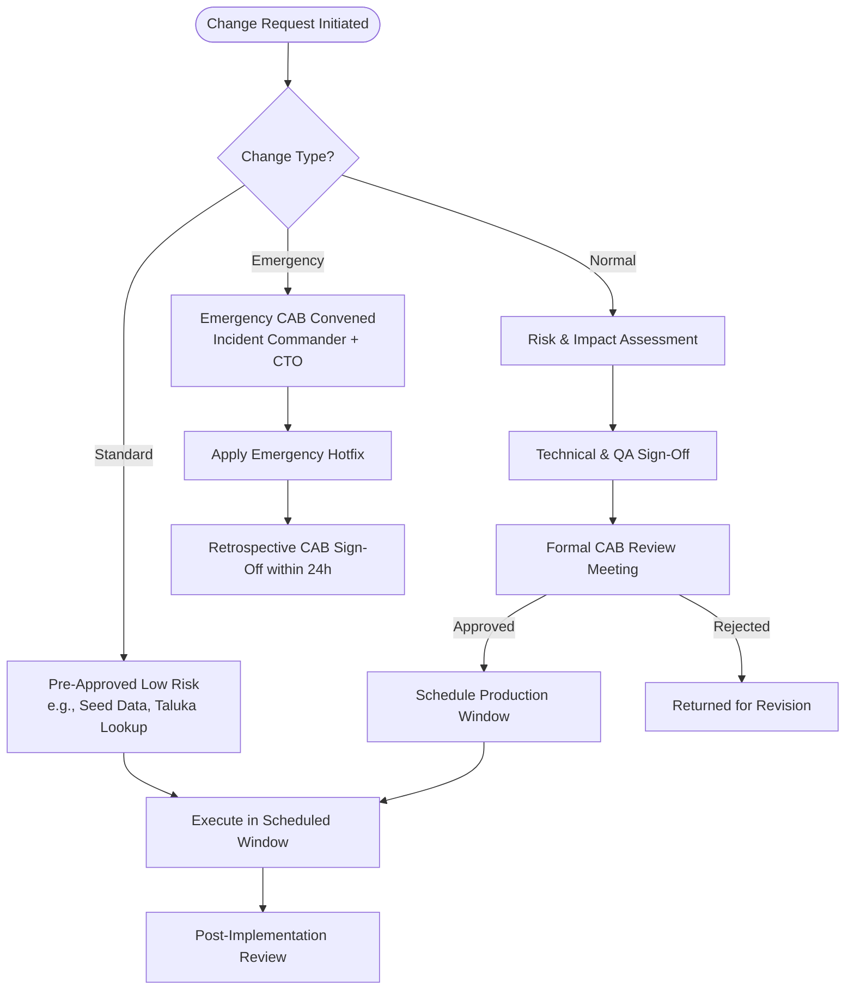

# Change Management Document (ITIL v4)

**Project Name:** Chara Chhavani (Digital Cattle Camp Management System)  
**Document Version:** 1.0.0  
**Status:** Approved  
**Framework:** ITIL v4 Change Enablement  
**Owner:** Change Advisory Board (CAB) Secretariat  

---

## 1. Objectives & Principles

The Chara Chhavani Change Management process balances the need for rapid feature evolution in response to government drought directives with the imperative of protecting system stability, financial subsidy integrity, and geofence data security.

### 1.1 Core Principles
1. **Zero Unapproved Production Mutations:** No code, database schema, or infrastructure configuration change may be introduced to production without formal CAB approval or pre-approved standard change status.
2. **Mandatory Automated Verification:** Every change must provide automated verification evidence (passing tests, regression suites, smoke tests) prior to submission.
3. **Tested Reversibility:** Every change proposal must contain a fully verified and time-bounded rollback plan.

---

## 2. Change Categories & Workflows

### 2.1 Category Definitions

| Change Category | Description | Approval Level | Lead Time | Execution Window |
|---|---|---|---|---|
| **Standard Change** | Low-risk, recurring, well-understood procedures (e.g., adding a new Taluka master record, rotating SSL certificates). | Pre-approved by Lead DevOps | 24 Hours | Low-traffic hours |
| **Normal Change** | Moderate to high-risk functional updates (e.g., new release v1.1.0, database schema migrations, modifying subsidy calculation algorithms). | Full CAB Review | 5 Business Days | Sunday 02:00–04:30 AM IST |
| **Emergency Change**| Critical fixes required to restore service during a P1 outage or seal a critical security/fraud vulnerability. | Emergency CAB (eCAB) | Immediate | Real-time under incident commander |

---

## 3. Change Advisory Board (CAB) Composition

The CAB convenes weekly (or ad-hoc for emergency changes) and comprises:
* **Chair:** Divisional Commissioner / Relief Commissionerate Representative
* **Technical Lead:** Principal Solutions Architect
* **Operations Lead:** Lead DevOps & SRE Engineer
* **Quality Lead:** Lead QA Automation SDET
* **Security Lead:** Chief Information Security Officer (CISO)
* **Business Lead:** District Animal Husbandry Officer

---

## 4. Post-Implementation Review (PIR) Protocol

Within 48 hours following any Normal or Emergency change:
1. SRE team reviews metric stability (error rates, P95 latency, memory consumption).
2. QA team verifies zero regression in automated end-to-end smoke test logs.
3. The Change Request ticket is updated with actual execution duration, encountered friction, and closed out.
