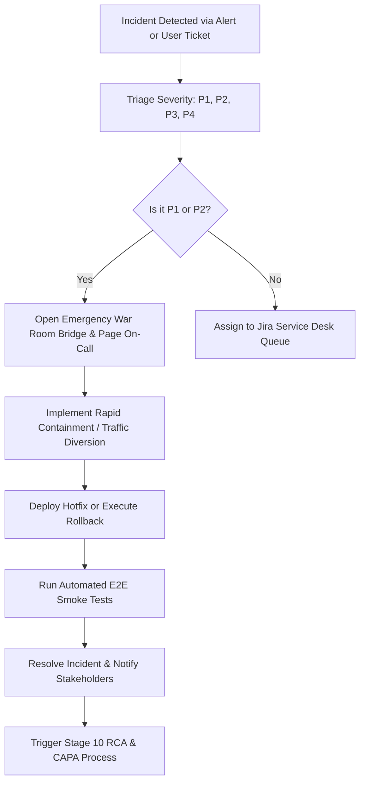

# Incident Management Protocol & Incident Reports

**Project Name:** Chara Chhavani (Digital Cattle Camp Management System)  
**Document Version:** 1.0.0  
**Status:** Approved  
**Framework:** ITIL v4 Incident Management  
**Escalation Lead:** Incident Commander & Lead SRE  

---

## 1. Incident Severity Classification & SLAs

Incidents are triaged based on business impact to cattle camp operations, statutory compliance, and data integrity:

| Severity Level | Definition | Impact Scope | MTTA (Acknowledge) | MTTR (Resolve) | Escalation Chain |
|---|---|---|---|---|---|
| **P1 - Critical** | Catastrophic outage or severe fraud compromise (e.g., WebAPI down statewide, database corruption, widespread geofence bypass). | All camps or entire district halted. | $< 10\text{ mins}$ | $< 2\text{ hours}$ | Incident Commander $\rightarrow$ CTO $\rightarrow$ Relief Commissioner |
| **P2 - Major** | Core module failure with no immediate workaround (e.g., animal admission API failing, CSV exports failing on audit day). | Single taluka or critical module affected. | $< 20\text{ mins}$ | $< 4\text{ hours}$ | Lead Architect $\rightarrow$ SRE Lead $\rightarrow$ District Collector |
| **P3 - Moderate**| Non-critical feature impairment with an available workaround (e.g., offline sync delay, image upload slow in 2G zone). | Isolated camp or non-blocking UI issue. | $< 1\text{ hour}$ | $< 12\text{ hours}$ | Senior Engineer $\rightarrow$ Module Lead |
| **P4 - Minor** | Cosmetic defect or minor operational inquiry (e.g., typo in Marathi translation label, minor chart alignment on mobile). | Minor annoyance, no business blockage. | $< 4\text{ hours}$ | $< 48\text{ hours}$ | Support Desk $\rightarrow$ Frontend Dev |

---

## 2. Incident Response Workflow

---

## 3. Historic Incident Post-Mortem Log

### Incident Case: INC-2026-0814 (P2 - FluentValidation 500 Unhandled Error)

* **Incident ID:** `INC-2026-0814`
* **Date & Time:** 2026-11-22 06:45:00 IST
* **Reported By:** QA Automation Smoke Test Suite
* **Symptoms:** Admin login endpoint (`POST /api/v1/auth/login`) with invalid password returned `HTTP 500 Internal Server Error` instead of expected `HTTP 400 Bad Request`.
* **Impact:** Automated smoke tests blocked; client received raw unhandled server error without field validation messages.
* **Root Cause:** `ExceptionHandlingMiddleware` only checked for internal `CustomValidationException`, allowing `FluentValidation.ValidationException` thrown by MediatR pipeline to fall through into the generic `500 InternalServerError` handler.
* **Immediate Corrective Action:** Added explicit catch block for `FluentValidation.ValidationException` inside `ExceptionHandlingMiddleware.cs` mapping failures to HTTP 400 with serialized error lists.
* **Preventive Action:** Added automated regression test `Login_WithInvalidCredentials_Returns400BadRequest` ensuring all validation exceptions return HTTP 400.
* **Status:** **RESOLVED & VERIFIED**
