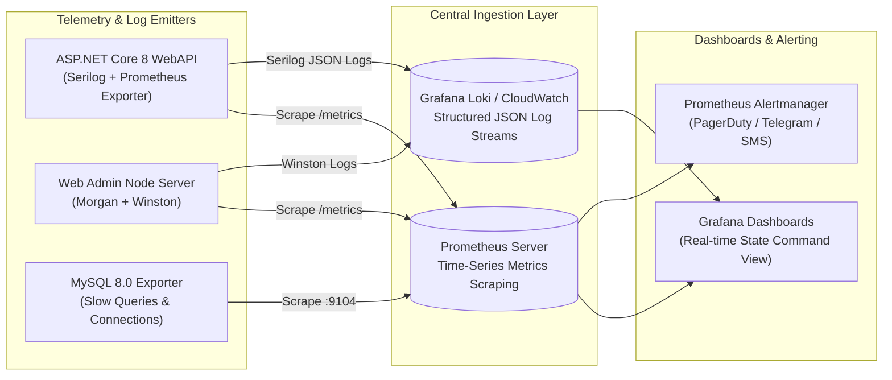

# Monitoring, Alerting & Service Level Agreement (SLA)

**Project Name:** Chara Chhavani (Digital Cattle Camp Management System)  
**Document Version:** 1.0.0  
**Status:** Approved  
**Observability Stack:** Prometheus, Grafana, CloudWatch, Serilog Structured Logging  
**Target Availability:** 99.9% Uptime (Tier-3 Government Standards)  

---

## 1. Service Level Agreements (SLA) & Commitments

The Chara Chhavani system guarantees the following service level commitments to district administrations and camp operators:

| Service Metric | SLA Target | Measurement Interval | Breach Definition |
|---|---|---|---|
| **Overall Platform Uptime** | **$\ge 99.9\%$** | Monthly Calendar | Down for $> 43.8\text{ minutes}$ in a calendar month. |
| **API Response Time (P95)** | **$< 250\text{ ms}$** | 5-Minute Moving Avg | P95 latency $> 500\text{ ms}$ sustained for $> 15\text{ minutes}$. |
| **Geofence Calculation Latency**| **$< 50\text{ ms}$** | Per-Transaction | NetTopologySuite query takes $> 150\text{ ms}$. |
| **CSV Export Streaming Speed** | **$> 10,000\text{ rows/sec}$**| Per-Export Request | File generation takes $> 10\text{ seconds}$. |
| **Data Durability (RPO)** | **$< 1\text{ Minute}$** | Continuous | Any unrecoverable committed transaction. |
| **Recovery Time Objective (RTO)**| **$< 15\text{ Minutes}$** | Disaster Recovery Event | Service downtime exceeding 15 minutes during disaster. |

---

## 2. Observability Architecture & Metrics Engine



---

## 3. Automated Alerting Thresholds & Paging Matrix

| Alert Name | Metric & Condition | Severity | Notification Channel | Auto-Remediation Trigger |
|---|---|---|---|---|
| `HighHttpErrorRate` | HTTP 5xx errors $> 0.5\%$ over 5 mins | **P1 - Critical** | SMS, Phone Call, Telegram | Trigger container auto-restart |
| `HighApiLatency` | P95 latency $> 500\text{ ms}$ over 10 mins | **P2 - Major** | Telegram, Email | Auto-scale backend replicas |
| `DatabaseHighConnections` | Active connections $> 85\%$ max pool | **P2 - Major** | Telegram, Email | Connection pool flush / scale |
| `GeofenceEvaluationFailure`| Geofence query exceptions $> 5$ in 5 mins | **P1 - Critical** | Phone Call, Telegram | Alert GIS on-call engineer |
| `DiskSpaceLow` | Persistent volume disk space $< 15\%$ | **P2 - Major** | Email, Telegram | Expand AWS EBS volume |
| `OfflineSyncBacklog` | Unsynced queue items $> 5,000$ systemwide | **P3 - Moderate** | Email | Notify taluka support lead |

---

## 4. Health Probes Implementation

Configured in `CharaChhavani.WebApi/Controllers/HealthController.cs`:

* **Liveness Probe (`GET /api/v1/health`):**
  * Verifies process memory allocation, garbage collection pressure, and thread pool health.
  * Returns `200 OK` with JSON envelope:
    ```json
    {
      "success": true,
      "message": "Service is healthy and operational",
      "data": { "status": "Healthy", "uptimeSeconds": 86400, "version": "1.0.0" }
    }
    ```
* **Readiness Probe (`GET /api/v1/health?full=true`):**
  * Verifies live database connectivity via `SELECT 1` on MySQL and checks Redis cache ping.
  * Returns `503 Service Unavailable` if database connection pool is exhausted or down.
