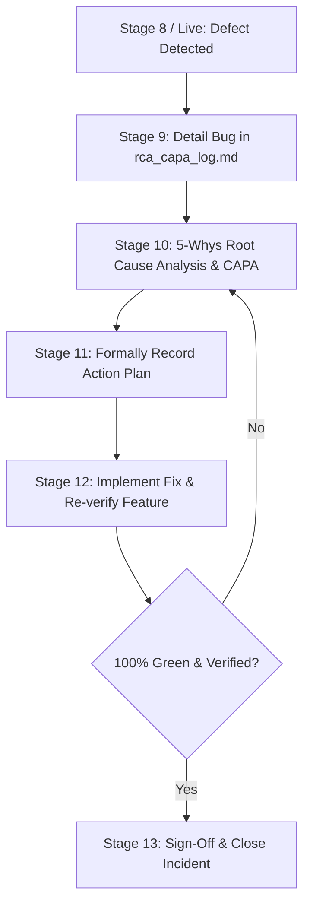

# Root Cause Analysis (RCA) & CAPA Procedures

**Project Name:** Chara Chhavani (Digital Cattle Camp Management System)  
**Document Version:** 1.0.0  
**Status:** Approved  
**Lifecycle Integration:** Governed by `GEMINI.md` Stages 9, 10, 11, and 12  
**Location of Live Log:** `docs/logs/rca_capa_log.md`  

---

## 1. The 13-Stage Quality Lifecycle Integration

Whenever an issue or defect is identified during development, testing, release, or production maintenance, the team strictly follows the 13-stage governance cycle defined in `GEMINI.md`:



---

## 2. RCA Methodology: The "5-Whys" Technique

Root Cause Analysis must not stop at superficial symptoms (e.g., "the variable was null"). Engineers must systematically drill down across five causal layers:

$$\text{Symptom} \longrightarrow \text{Trigger} \longrightarrow \text{Code Flaw} \longrightarrow \text{Design Gap} \longrightarrow \text{Systemic / Architecture Cause}$$

### Example 5-Whys Analysis (Geofence Breach in Smoke Test)
1. **Why did the smoke test fail?**  
   $\rightarrow$ The animal admission API rejected the test coordinates with HTTP 403 Forbidden.
2. **Why was it rejected?**  
   $\rightarrow$ The coordinates $(19.4795, 75.0123)$ fell outside the Paithan camp geofence polygon.
3. **Why did the test use those coordinates?**  
   $\rightarrow$ The test script had hardcoded coordinates from a different village outside Paithan.
4. **Why weren't the correct camp centroid coordinates used?**  
   $\rightarrow$ The test harness did not query the camp's actual geographic centroid before issuing the admission command.
5. **Why was there no automated alignment?**  
   $\rightarrow$ Test suites lacked a dynamic location fixture helper matching target camp IDs.  
   **Root Cause:** Test fixture decoupled from dynamic database seed data.

---

## 3. Corrective & Preventive Action (CAPA) Protocol

Every post-mortem requires two distinct tiers of action:

### 3.1 Corrective Action (Immediate)
* The immediate code fix, patch, or configuration update applied to resolve the active failure and restore system operation.
* Must be verified by re-running the specific failing test case.

### 3.2 Preventive Action (Long-Term Architectural Safeguard)
* A systemic mechanism guaranteeing the defect cannot recur anywhere across the system:
  1. **New Automated Regression Test:** A permanent test added to the CI suite.
  2. **Type / Compiler Constraint:** Enforcing invariant at compile time (e.g., non-nullable properties, custom value objects).
  3. **Architecture Rule:** Adding Roslyn analyzer rule or ESLint rule.
  4. **Pipeline Guardrail:** Adding a build pre-processor or validation middleware.

---

## 4. Formal RCA & CAPA Report Template

```markdown
### RCA & CAPA Report: [INCIDENT-OR-BUG-ID] - [TITLE]

* **Date:** YYYY-MM-DD
* **Severity:** Critical / High / Medium / Low
* **Component:** [Backend / Mobile / Database / DevOps]
* **Lead Investigator:** [Engineer Name]

#### 1. Problem Description
* **Steps to Reproduce:**
* **Expected Result:**
* **Actual Result:**
* **Error Logs / Stack Trace:**

#### 2. Root Cause Analysis (5-Whys)
1. Why? ...
2. Why? ...
3. Why? ...
4. Why? ...
5. Why? (Fundamental Root Cause): ...

#### 3. Corrective Action (Immediate Fix)
* **Code Changes:** [File links and PR commit]
* **Verification:** [Test output and verification date]

#### 4. Preventive Action (CAPA Safeguards)
* **Automated Safeguard:** [New unit/integration test ID]
* **Architecture / Process Update:** [Rule update in GEMINI.md or linter]

#### 5. Verification & Closure Sign-Off
* **Verified By:** [QA Lead / Architect]
* **Closure Date:** YYYY-MM-DD
```
