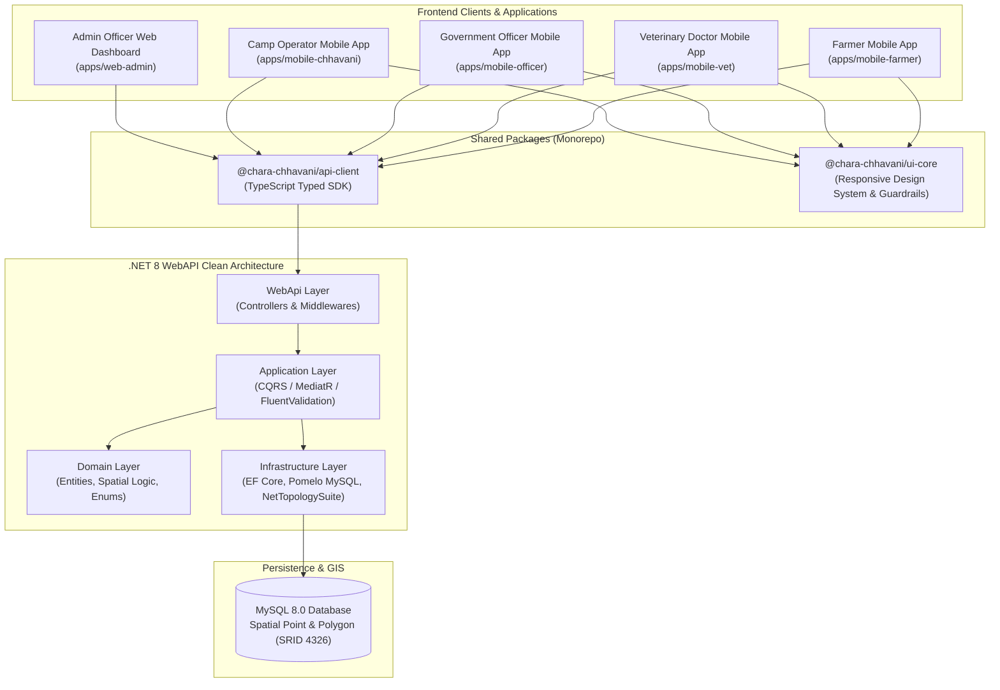

# Chara Chhavani Management System (चारा छावणी व्यवस्थापन प्रणाली)

[](https://github.com/Shubham-bi/Chara-Chavani/actions/workflows/ci.yml)
[](https://dotnet.microsoft.com/)
[-blue.svg)](https://www.mysql.com/)
[](https://reactnative.dev/)
[](https://www.typescriptlang.org/)
[](LICENSE)

An enterprise-grade, geofence-enforced relief cattle camp management system built for the **Department of Relief and Rehabilitation & Animal Husbandry, Government of Maharashtra**. Designed to preserve livestock, ensure transparent fodder distribution, eliminate ghost cattle registrations, and guarantee fiscal accountability during acute regional droughts.

---

## 🏛️ System Architecture



---

## 📱 Role-Based Applications

| Role | Interface | Primary Auth | Core Capabilities |
| :--- | :--- | :--- | :--- |
| **Farmer (शेतकरी)** | Mobile App | Mobile + OTP | Animal registration, cattle photo upload, approval tracking, camp admission status. |
| **Vet Doctor (पशुवैद्यकीय अधिकारी)** | Mobile App | Mobile + OTP | Physical inspection visit, farmer GPS coordinates stamping (`Point`), approve/reject with mandatory remarks. |
| **Camp Operator (छावणी चालक)** | Mobile App | Mobile + OTP | Geofence-guarded animal admission, live gate photo check, dual-source fodder stock (Store vs In-Farm), daily feeding records, expense tracking. |
| **Field Officer (शासकीय अधिकारी)** | Mobile App | Mobile + OTP | Camp registration, geofence boundary configuration, surprise field headcount audit ($\Delta = C_{physical} - C_{system}$), discrepancy flagging. |
| **State Admin (जिल्हा/राज्य प्रशासन)** | Web Dashboard | Username + Password | Real-time district KPIs, camp capacity utilization, total government relief expenditure, fodder stock monitoring, inspection discrepancy audit, CSV compliance exports. |

---

## 🔒 Key Business & Technical Rules

1. **Geofence Separation (Critical Anti-Fraud Guardrail):**
   - **Veterinary Doctor Verification:** Records the farmer's farm GPS location (`Point`). It is **never** checked against cattle camp geofences.
   - **Animal Admission:** Enforces a server-side point-in-polygon containment check against the camp's WGS84 `Polygon` geofence boundary. If outside, admission is rejected immediately.
2. **Rule 9.6 Anti-Fraud Invariant (No Offline Admission):**
   - Rule 9.6 of the development guidelines strictly prohibits offline animal admissions. The mobile client architecture (`OfflineActionQueue`) permits drafting registrations but explicitly throws `ERR_ONLINE_GEOFENCE_REQUIRED` when attempting offline admissions.
3. **Devanagari Line-Height Resilience:**
   - All mobile typography tokens in `@chara-chhavani/ui-core` enforce $\text{lineHeight} \ge 1.35 \times \text{fontSize}$ to prevent vertical clipping of Marathi vowels and matras (ु, ू, ौ).
4. **Anti-Overflow & Anti-Overlap Standards:**
   - Every screen is encased in `ScreenContainerLayout` (Safe Area + Keyboard Avoiding + Scrollable `flexGrow: 1`).
   - Grid columns automatically stack to 100% width on budget smartphones ($< 360\text{ dp}$).
   - Minimum $48 \times 48\text{ dp}$ interactive touch targets for outdoor usability.
5. **Dual-Source Inventory & Unit Normalization:**
   - Fodder stock is strictly segregated into `Store` and `InFarm`.
   - Inventory calculations are normalized to kilograms ($1\text{ quintal} = 100\text{ kg}$).
   - Non-negative stock guards prevent overdrafts; all stock adjustments require an audit reason.
6. **Role-Based Authentication:**
   - Mobile field users authenticate using **Mobile Number + OTP**.
   - State Administrators authenticate using **Username + Password** for the Web Dashboard.

---

## 📊 State Government Audit & Compliance Reporting Engine

To ensure transparency and prevent fiscal fraud in drought relief subsidies, the system provides automated audit reports and streaming **RFC 4180 CSV exports with UTF-8 BOM (`\uFEFF`)** for seamless regional Marathi rendering in Microsoft Excel:

| Report Type | Endpoint | Capabilities & Audit Equation |
| :--- | :--- | :--- |
| **Admissions Audit** | `/api/v1/admin/reports/admissions` | Itemized cattle admission/release records, active camp days for per-day subsidy calculation, masked Aadhaar/mobile. |
| **Fodder Reconciliation** | `/api/v1/admin/reports/fodder-reconciliation` | Balances purchases against feeding and wastage: $\text{Purchases} - \text{Fed} \pm \text{Adjustments} = \text{Available Stock}$. |
| **Expenses Audit** | `/api/v1/admin/reports/expenses` | Itemized breakdown by category (water supply tankers, labour, electricity, transportation). |
| **Inspections Audit** | `/api/v1/admin/reports/inspections` | Government officer field inspection logs and physical vs system cattle headcount discrepancy ($\Delta$). |
| **CSV Stream Export** | `/api/v1/admin/reports/export?reportType=...` | Direct file stream for treasury auditors with UTF-8 BOM encoding. |

---

## 🚀 Quickstart & Deployment

### Option A: Run with Docker Compose (Recommended)
Spin up MySQL 8.0 (with GIS extensions & persistent storage), .NET 8 WebAPI, and Nginx Web Admin Dashboard in one command:
```bash
docker compose up -d --build
```
- **WebAPI Swagger**: `http://localhost:5000/swagger`
- **Web Admin Dashboard**: `http://localhost:3000`
- **MySQL 8.0 GIS**: `localhost:3306` (`chara_chhavani_db`)

---

### Option B: Local Development Setup

#### Prerequisites
- [.NET 8 SDK](https://dotnet.microsoft.com/download/dotnet/8.0)
- [Node.js 18+](https://nodejs.org/) & npm
- [MySQL Server 8.0](https://dev.mysql.com/downloads/mysql/)

#### 1. Configure Local Database Credentials (`backend/.env`)
Create `backend/.env` with your local MySQL credentials:
```env
USERNAME=root
PASSWORD=NewPassword@123
```
*(The custom `EnvLoader.cs` securely isolates database credentials without colliding with the Windows OS `USERNAME` environment variable).*

#### 2. Apply Database Migrations & Seed Baseline Data
```powershell
cd backend
dotnet ef database update --project src/CharaChhavani.Infrastructure --startup-project src/CharaChhavani.WebApi
```

#### 3. Run the Backend WebAPI
```powershell
cd src/CharaChhavani.WebApi
dotnet run
```
Access Swagger UI at `http://localhost:5000/swagger`.

#### 4. Run Automated End-to-End Smoke Test
Verify the complete 8-step pipeline against the running API:
```powershell
.\scripts\e2e_smoke_test.ps1 -ApiBaseUrl "http://localhost:5000"
```

#### 5. Interactive Testing via VS Code / Visual Studio REST Client
Open [CharaChhavani.http](backend/CharaChhavani.http) directly in your IDE to test all 12 controllers and endpoints interactively with pre-configured sample JSON payloads.

---

## 📁 Repository Directory Structure

```
Chara-Chhavani/
├── .github/
│   └── workflows/ci.yml               # Automated CI pipeline (.NET 8, Node tests, Docker build)
├── GEMINI.md                          # Strict 13-stage engineering governance rules
├── docker-compose.yml                 # Multi-tier Docker Compose specification
├── backend/                           # .NET 8 Clean Architecture Solution
│   ├── .env                           # Local MySQL credentials (git-ignored)
│   ├── .env.example                   # Template credentials file
│   ├── Dockerfile                     # Multi-stage build with non-root security context
│   ├── CharaChhavani.http             # RFC-compliant REST client collection
│   ├── src/
│   │   ├── CharaChhavani.Domain/      # Entities, Enums, NetTopologySuite Geometries
│   │   ├── CharaChhavani.Application/ # CQRS (Commands, Queries, Reporting, Validators)
│   │   ├── CharaChhavani.Infrastructure/ # EF Core, Pomelo MySQL, Database Seeder
│   │   └── CharaChhavani.WebApi/      # REST API Controllers & Swagger UI
│   └── tests/
│       └── CharaChhavani.UnitTests/   # 67 automated unit & MySQL persistence tests
├── packages/
│   ├── api-client/                    # Centralized TypeScript HTTP Client SDK
│   └── ui-core/                       # Responsive mobile design system & guardrails
├── apps/
│   ├── mobile-farmer/                 # React Native Farmer Mobile App
│   ├── mobile-vet/                    # React Native Veterinary Doctor App
│   ├── mobile-officer/                # React Native Government Field Officer App
│   ├── mobile-chhavani/               # React Native Camp Operator App
│   └── web-admin/                     # React + TypeScript Web Admin Dashboard
├── scripts/
│   └── e2e_smoke_test.ps1             # Automated end-to-end smoke test runner
└── docs/
    ├── understanding/                 # Stage 2: Feature understanding specs
    ├── plans/                         # Stage 3: Granular task checklists
    └── logs/                          # Challenges & Solutions, RCA/CAPA logs
```

---

## 🧪 Quality Assurance & Test Coverage

- **67 Automated Unit & Integration Tests Passing** in `CharaChhavani.UnitTests`:
  - NetTopologySuite Point-in-Polygon containment & auto-closing linear rings.
  - Farmer registration and duplicate mobile idempotency.
  - Veterinary doctor GPS stamping vs camp geofence separation.
  - Fodder stock non-negative guards & quintal unit conversions.
  - Fodder stock mathematical balance reconciliation.
  - Officer inspection headcount discrepancy variance computation ($\Delta$).
  - RFC 4180 CSV export with UTF-8 BOM encoding.
  - Mobile OTP simulation & Admin password authentication.
  - Live MySQL end-to-end data storage and spatial retrieval.
- **Rule 9.6 Offline Guard Tests Passing**:
  - `OfflineActionQueue` validates draft preservation while strictly forbidding offline animal admissions.
- **Zero TypeScript Errors** across all frontend apps and shared packages.
