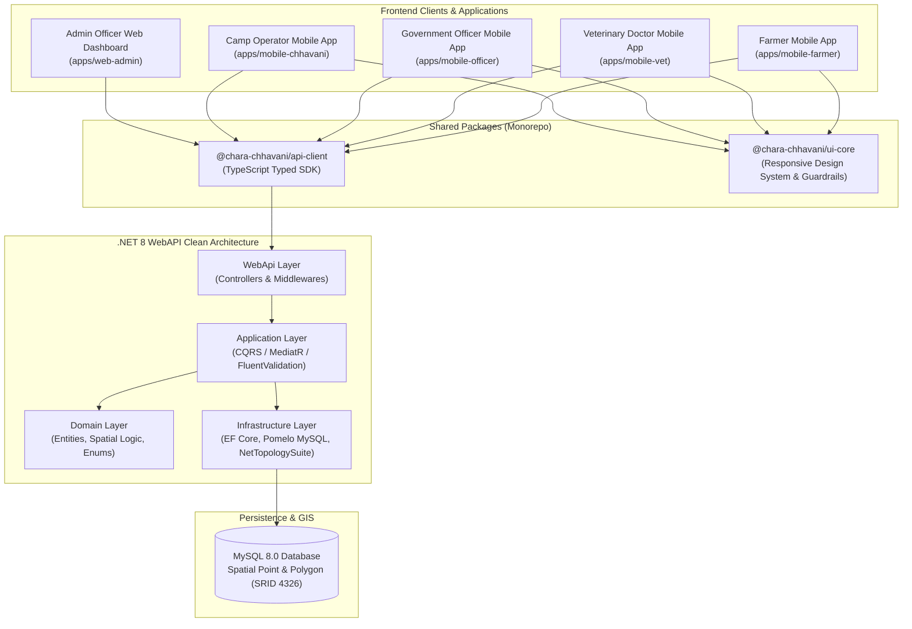

# Chara Chhavani Management System (चारा छावणी व्यवस्थापन प्रणाली)

[](https://dotnet.microsoft.com/)
[-blue.svg)](https://www.mysql.com/)
[](https://reactnative.dev/)
[](https://www.typescriptlang.org/)
[](LICENSE)

An enterprise-grade, geofence-enforced relief cattle camp management system built for the **Department of Relief and Rehabilitation & Animal Husbandry, Government of Maharashtra**. Designed to preserve livestock, ensure transparent fodder distribution, eliminate ghost cattle registrations, and guarantee fiscal accountability during acute regional droughts.

---

## 🏛️ System Architecture



---

## 📱 Role-Based Applications

| Role | Interface | Primary Auth | Core Capabilities |
| :--- | :--- | :--- | :--- |
| **Farmer (शेतकरी)** | Mobile App | Mobile + OTP | Animal registration, cattle photo upload, approval tracking, camp admission status. |
| **Vet Doctor (पशुवैद्यकीय अधिकारी)** | Mobile App | Mobile + OTP | Physical inspection visit, farmer GPS coordinates stamping (`Point`), approve/reject with mandatory remarks. |
| **Camp Operator (छावणी चालक)** | Mobile App | Mobile + OTP | Geofence-guarded animal admission, live gate photo check, dual-source fodder stock (Store vs In-Farm), daily feeding records, expense tracking. |
| **Field Officer (शासकीय अधिकारी)** | Mobile App | Mobile + OTP | Camp registration, geofence boundary configuration, surprise field headcount audit ($\Delta = C_{physical} - C_{system}$), discrepancy flagging. |
| **State Admin (जिल्हा/राज्य प्रशासन)** | Web Dashboard | Username + Password | Real-time district KPIs, camp capacity utilization, total government relief expenditure, fodder stock monitoring, inspection discrepancy audit. |

---

## 🔒 Key Business & Technical Rules

1. **Geofence Separation (Critical Anti-Fraud Guardrail):**
   - **Veterinary Doctor Verification:** Records the farmer's farm GPS location (`Point`). It is **never** checked against cattle camp geofences.
   - **Animal Admission:** Enforces a server-side point-in-polygon containment check against the camp's WGS84 `Polygon` geofence boundary. If outside, admission is rejected immediately.
2. **Devanagari Line-Height Resilience:**
   - All mobile typography tokens in `@chara-chhavani/ui-core` enforce $\text{lineHeight} \ge 1.35 \times \text{fontSize}$ to prevent vertical clipping of Marathi vowels and matras (ु, ू, ौ).
3. **Anti-Overflow & Anti-Overlap Standards:**
   - Every screen is encased in `ScreenContainerLayout` (Safe Area + Keyboard Avoiding + Scrollable `flexGrow: 1`).
   - Grid columns automatically stack to 100% width on budget smartphones ($< 360\text{ dp}$).
   - Minimum $48 \times 48\text{ dp}$ interactive touch targets for outdoor usability.
4. **Dual-Source Inventory & Unit Normalization:**
   - Fodder stock is strictly segregated into `Store` and `InFarm`.
   - Inventory calculations are normalized to kilograms ($1\text{ quintal} = 100\text{ kg}$).
   - Non-negative stock guards prevent overdrafts; all stock adjustments require an audit reason.
5. **Role-Based Authentication:**
   - Mobile field users authenticate using **Mobile Number + OTP**.
   - State Administrators authenticate using **Username + Password** for the Web Dashboard.

---

## 🚀 Getting Started

### Prerequisites
- [.NET 8 SDK](https://dotnet.microsoft.com/download/dotnet/8.0)
- [Node.js 18+](https://nodejs.org/) & npm
- [MySQL Server 8.0](https://dev.mysql.com/downloads/mysql/)

### 1. Configure Local Database (`backend/.env`)
Create `backend/.env` with your local MySQL credentials:
```env
USERNAME=root
PASSWORD=NewPassword@123
```

### 2. Apply Database Migrations & Seed Baseline Data
```powershell
# Navigate to backend
cd backend

# Apply EF Core migrations to local MySQL (creates 13 tables with spatial indexes)
dotnet ef database update --project src/CharaChhavani.Infrastructure --startup-project src/CharaChhavani.WebApi

# Run automated tests (includes live MySQL persistence and seeder tests)
dotnet test ../backend/CharaChhavani.sln
```

### 3. Build Shared Packages & Applications
```powershell
# Build shared TypeScript API Client
cd ../packages/api-client
npm run build

# Build responsive mobile UI Core library
cd ../ui-core
npm run build

# Typecheck mobile apps
cd ../../apps/mobile-farmer && npx -p typescript tsc --noEmit
cd ../mobile-vet && npx -p typescript tsc --noEmit
cd ../mobile-officer && npx -p typescript tsc --noEmit
cd ../mobile-chhavani && npx -p typescript tsc --noEmit
cd ../web-admin && npx -p typescript tsc --noEmit
```

### 4. Run the Backend WebAPI
```powershell
cd ../../backend/src/CharaChhavani.WebApi
dotnet run
```
Access Swagger UI at `http://localhost:5000/swagger`.

---

## 📁 Repository Directory Structure

```
Chara-Chhavani/
├── GEMINI.md                          # Strict 13-stage engineering governance rules
├── backend/                           # .NET 8 Clean Architecture Solution
│   ├── .env                           # Local MySQL credentials (git-ignored)
│   ├── .env.example                   # Template credentials file
│   ├── src/
│   │   ├── CharaChhavani.Domain/      # Entities, Enums, Spatial Geometries
│   │   ├── CharaChhavani.Application/ # CQRS (Commands, Queries, Validators)
│   │   ├── CharaChhavani.Infrastructure/ # EF Core, MySQL, Database Seeder
│   │   └── CharaChhavani.WebApi/      # REST API Controllers & Swagger
│   └── tests/
│       └── CharaChhavani.UnitTests/   # 63 automated unit & MySQL persistence tests
├── packages/
│   ├── api-client/                    # Centralized TypeScript HTTP Client SDK
│   └── ui-core/                       # Responsive mobile design system & guardrails
├── apps/
│   ├── mobile-farmer/                 # React Native Farmer Mobile App
│   ├── mobile-vet/                    # React Native Veterinary Doctor App
│   ├── mobile-officer/                # React Native Government Field Officer App
│   ├── mobile-chhavani/               # React Native Camp Operator App
│   └── web-admin/                     # React + TypeScript Web Admin Dashboard
└── docs/
    ├── understanding/                 # Stage 2: Feature understanding specs
    ├── plans/                         # Stage 3: Granular task checklists
    └── logs/                          # Challenges & Solutions, RCA/CAPA logs
```

---

## 🧪 Quality Assurance & Test Coverage
- **63 Automated Tests Passing** in `CharaChhavani.UnitTests`:
  - Spatial Point-in-Polygon containment & auto-closing linear rings.
  - Farmer registration and duplicate mobile idempotency.
  - Veterinary doctor GPS stamping vs camp geofence separation.
  - Fodder stock non-negative guards & quintal unit conversions.
  - Officer inspection headcount discrepancy variance computation.
  - Mobile OTP simulation & Admin password authentication.
  - Live MySQL end-to-end data storage and spatial retrieval.
- **Zero TypeScript Errors** across all frontend apps and shared packages.
