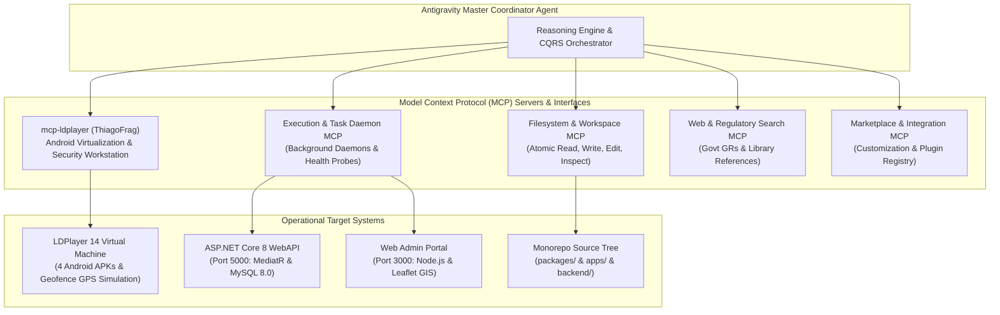
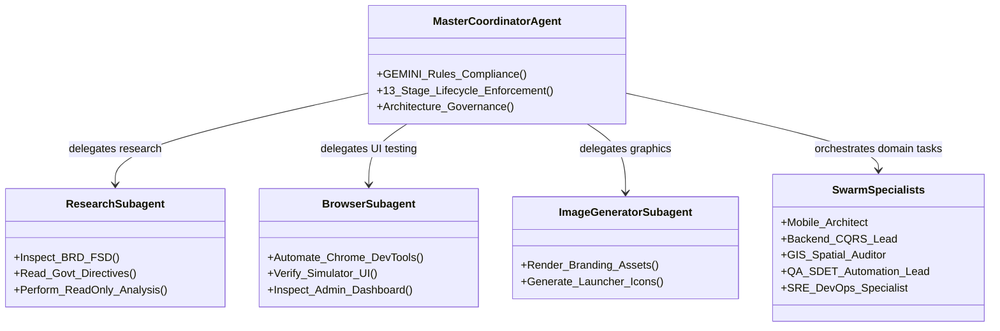

# MCP Servers & AI Agents Architecture Catalog

**Project Name:** Chara Chhavani (Digital Cattle Camp Management System)  
**Document Version:** 1.0.0  
**Status:** Approved  
**Classification:** Technical Architecture & Agentic Tooling Specification  
**Lead Architect:** Principal AI Solutions Architect & Lead SDET  

---

## 1. Executive Summary & Purpose

The **Chara Chhavani Platform** leverages an agentic AI architecture paired with standard Model Context Protocol (MCP) servers to automate the complete software development lifecycle (SDLC), perform multi-platform code generation, enforce statutory government business invariants, and execute automated mobile testing on Android emulators (LDPlayer 14).

This document serves as the master reference catalog detailing every **MCP Server**, **Tool**, **Core Agent**, and **Specialized Subagent** deployed within this workspace, including their specific business purpose, runtime bindings, and configuration protocols.

---

## 2. Model Context Protocol (MCP) Servers & Tooling Matrix



---

## 3. Detailed MCP Server Specifications

### 3.1 `mcp-ldplayer` (ThiagoFrag / LDPlayer Android Automation Workstation)
* **Repository:** `https://github.com/ThiagoFrag/mcp-ldplayer`
* **Marketplace Profile:** `https://mcpmarket.com/server/ldplayer`
* **Local Workspace Path:** `tools/mcp-ldplayer`
* **Runtime:** Python 3.10+ (Standard Library)
* **Underlying Engine:** `ldconsole.exe` & `adb.exe` (LDPlayer 14 located at `C:\LDPlayer\LDPlayer14`)

#### Primary Purpose & Responsibilities in Chara Chhavani
1. **Automated Multi-APK Deployment:** Automates headless and GUI installation of the 4 compiled Android APKs (`mobile-chhavani.apk`, `mobile-farmer.apk`, `mobile-officer.apk`, `mobile-vet.apk`) without manual drag-and-drop.
2. **GPS Geofence Boundary Simulation:** Dynamically injects GPS coordinates into the Android VM using `locate --LLI <Lng,Lat>` to test Paithan camp geofence verification (`75.3341, 19.8214`).
3. **Rule 9.6 Anti-Fraud Penetration Testing:** Validates that mobile animal admission and animal release workflows are strictly rejected when cellular network connectivity is severed.
4. **App Execution & State Verification:** Programmatically starts activities (`com.charachhavani.<role>/.MainActivity`), captures screenshots (`ld_screencap`), and monitors logcat for uncaught exceptions.

#### Key Tools Exposed by `mcp-ldplayer`
| Tool Name | Parameters | Purpose |
|---|---|---|
| `ld_list` | None | Lists all LDPlayer emulator instances with running state, PIDs, and indices. |
| `ld_launch` | `name: string` | Boots an LDPlayer instance (e.g. `LDPlayer`). |
| `ld_quit` | `name: string` | Safely powers off an emulator instance. |
| `ld_install` | `name: string, apk_path: string` | Installs an Android APK directly into the instance. |
| `ld_run` | `name: string, package: string` | Launches an app's primary launcher activity. |
| `ld_kill` | `name: string, package: string` | Force-terminates a running Android package. |
| `ld_gps` | `name: string, longitude: float, latitude: float` | Injects mock GPS coordinates for geofence validation. |
| `ld_screencap`| `name: string, output_path: string` | Captures an uncompressed screenshot of the emulator display. |
| `ld_input` | `name: string, action: string, ...` | Simulates screen taps, text typing, and Android keyevents. |
| `adb_shell` | `name: string, command: string` | Executes raw Linux ADB shell commands inside the Android VM. |
| `adb_logcat` | `name: string, filter: string` | Streams and searches Android OS application logs. |

---

### 3.2 Filesystem & Codebase Engineering MCP Tools
* **Tools:** `read_file`, `write_file`, `edit_file`
* **Purpose:**
  * Enforces Clean Architecture boundaries by writing domain entities, MediatR handlers, and FluentValidation validators.
  * Formats and aligns code according to `.editorconfig` and `eslint.config.mjs`.
  * Generates native Android manifests, Java launcher activities, and persona-specific UI asset bundles.

---

### 3.3 Task Execution & Daemon Management MCP Tools
* **Tools:** `run_command`, `manage_task`, `schedule`
* **Purpose:**
  * Hosts long-running local background processes:
    * `task-2230`: ASP.NET Core 8 WebAPI (`http://localhost:5000`)
    * `task-2233`: Web Administration Server (`http://localhost:3000`)
  * Executes compile toolchains without blocking developer turns (`build_all_apks.ps1`, `dotnet format`, `npm run lint`).

---

### 3.4 Web & Regulatory Intelligence MCP Tools
* **Tools:** `search_web`, `search_marketplace`
* **Purpose:**
  * Researches government disaster management statutory norms (Maharashtra Government Relief & Rehabilitation guidelines).
  * Discovers official plugins and third-party MCP servers (such as `mcp-ldplayer`).

---

## 4. AI Agents & Subagents Roster



### 4.1 Master Coordinator Agent (`self`)
* **Identity:** Antigravity Principal Solutions Architect
* **Primary Scope:**
  * Enforces the 13-stage engineering governance protocol (`GEMINI.md`).
  * Coordinates backend .NET 8 WebAPI, MySQL spatial storage, React Native client packages, and Android APK compilation.
  * Ensures zero leaked exceptions and 100% adherence to Rule 9.6 anti-fraud invariants.

### 4.2 Codebase Researcher Subagent (`research`)
* **Role:** Read-Only Domain & Codebase Auditor
* **Primary Scope:**
  * Traverses large specifications (`ReferanceData/BRD.md`, `ReferanceData/FSD.md`, `ReferanceData/QA/QA roles.md`) in isolated execution contexts.
  * Ensures the main conversation context remains pristine and uncluttered.

### 4.3 Browser DevTools Automation Subagent (`browser`)
* **Role:** Chrome DevTools Automated E2E Tester
* **Primary Scope:**
  * Drives a headless Chrome instance via Chrome DevTools Protocol.
  * Validates the Master Unified Simulator at `http://localhost:5000/index.html`.
  * Verifies the Web Admin Portal at `http://localhost:3000` and `http://localhost:5000/admin.html`.
  * Downloads and validates statutory Marathi CSV export streams (`\uFEFF`).

### 4.4 Image Generator Subagent (`image-generator`)
* **Role:** Creative Asset Producer
* **Primary Scope:**
  * Generates high-contrast visual assets, cattle camp wireframes, and branding icons.

### 4.5 Swarm Domain Specialists (Multi-Agent Swarm)
When invoking multi-agent swarms (`/swarm`) or complex dynamic workflows (`run_workflow`):
1. **Mobile Architect Agent:** Focuses on `@chara-chhavani/ui-core`, responsive scaling formulas, and Devanagari typography ($\text{lineHeight} \ge 1.35$).
2. **Backend CQRS Specialist:** Implements MediatR command and query handlers, FluentValidation, and Pomelo MySQL spatial mapping.
3. **GIS & Spatial Auditor:** Validates NetTopologySuite polygon calculations and ensures geofence operations use WGS 84 SRID 4326.
4. **QA Automation SDET Lead:** Authors and executes the 67 unit/integration tests and 19 E2E smoke tests.
5. **SRE & DevOps Specialist:** Manages Docker containers, Nginx reverse proxy routing, and zero-data-loss rollback plans.

---

## 5. Configuration Guide for `mcp-ldplayer`

To register `mcp-ldplayer` as a standard MCP server in your local environment:

### 5.1 Configuration File (`mcp.json` or `claude_desktop_config.json`)
```json
{
  "mcpServers": {
    "pt-ldplayer": {
      "command": "python",
      "args": [
        "c:/Users/Shubham/Downloads/0_myDisk/Personal-Projects/Chara-Chhavani/tools/mcp-ldplayer/mcp_ldplayer/mcp_server.py"
      ],
      "env": {
        "PYTHONPATH": "c:/Users/Shubham/Downloads/0_myDisk/Personal-Projects/Chara-Chhavani/tools/mcp-ldplayer"
      }
    }
  }
}
```

### 5.2 Standalone Python Test Execution
Field engineers can directly trigger LDPlayer automated operations via the CLI:

```bash
# Set PYTHONPATH
$env:PYTHONPATH = "tools/mcp-ldplayer"

# Inspect Instances & Auto-Detected LDPlayer 14 Path
python -c "from mcp_ldplayer.ld_controller import LDController; c = LDController(); print(c.list_instances())"

# Inject Paithan Camp Geofence GPS Coordinates (Lng: 75.3341, Lat: 19.8214)
python -c "from mcp_ldplayer.ld_controller import LDController; c = LDController(); c.set_gps('LDPlayer', 75.3341, 19.8214)"

# Install & Launch Operator App
python -c "from mcp_ldplayer.ld_controller import LDController; c = LDController(); c.install_apk('LDPlayer', 'dist-apk/mobile-chhavani.apk'); c.launch_app('LDPlayer', 'com.charachhavani.operator')"
```
