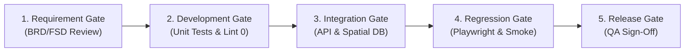

# Chara Chhavani Management System: MCP Servers, Specialized AI Agents & QA Architecture Guide

**System:** Chara Chhavani (Maharashtra Cattle Camp Management & Fodder Distribution System)  
**Document Version:** 1.0.0  
**Classification:** Enterprise Engineering, QA & AI Operations Standard  
**Governance Standard:** Aligned with `GEMINI.md` Strict Lifecycle & [ReferanceData/QA/QA roles.md](file:///c:/Users/Shubham/Downloads/0_myDisk/Personal-Projects/Chara-Chhavani/ReferanceData/QA/QA%20roles.md)  

---

## 1. Executive Summary & 3-Tier Architectural Hierarchy

The Chara Chhavani Management System operates across a three-tier architecture connecting specialized domain AI agents, Model Context Protocol (MCP) servers, and the underlying multi-tier codebase and infrastructure.

```mermaid
flowchart TD
    subgraph Tier1["Tier 1: Specialized Domain AI Agents"]
        AgentDB["MySQL & GIS Data Agent"]
        AgentBE["Backend .NET Architect Agent"]
        AgentRN["React Native Mobile Agent"]
        AgentAPI["API Contract & Sync Agent"]
        AgentQA["QA & Geofence Test Agent"]
        AgentPW["Playwright E2E Engineer Agent"]
        AgentLD["LDPlayer Mobile Automation Agent"]
        AgentDevOps["DevOps & Release Agent"]
    end

    subgraph Tier2["Tier 2: Model Context Protocol (MCP) Server Layer"]
        MCPMySQL["MySQL MCP Server (@modelcontextprotocol/server-mysql)"]
        MCPDotnet["Dotnet / Roslyn Execution MCP (dotnet-cli)"]
        MCPSwagger["OpenAPI / Swagger MCP (@modelcontextprotocol/server-fetch)"]
        MCPFigma["Figma MCP (@modelcontextprotocol/server-figma)"]
        MCPGit["Git & Filesystem MCP (@modelcontextprotocol/server-git)"]
        MCPPlaywright["Playwright MCP (@executeautomation/playwright-mcp-server)"]
        MCPLDPlayer["LDPlayer 14 MCP (tools/mcp-ldplayer)"]
        MCPChrome["Chrome DevTools MCP (chrome-devtools-plugin)"]
    end

    subgraph Tier3["Tier 3: Chara Chhavani Codebase & Runtime Targets"]
        DB[("MySQL 8.0+ Database (Spatial Polygon & Point Indexes)")]
        BE["ASP.NET Core WebAPI (.NET 8 Clean Architecture - Port 5000)"]
        Apps["4x React Native Mobile Apps (Farmer, Vet, Officer, Operator)"]
        WebAdmin["Web Admin Dashboard (Node HTTP Server - Port 3000)"]
        LD14["LDPlayer 14 Android Emulator (dnplayer.exe)"]
    end

    AgentDB --> MCPMySQL
    AgentBE --> MCPDotnet
    AgentBE --> MCPSwagger
    AgentRN --> MCPFigma
    AgentAPI --> MCPSwagger
    AgentQA --> MCPDotnet
    AgentQA --> MCPPlaywright
    AgentPW --> MCPPlaywright
    AgentPW --> MCPChrome
    AgentLD --> MCPLDPlayer
    AgentDevOps --> MCPGit
    AgentDevOps --> MCPDotnet

    MCPMySQL --> DB
    MCPDotnet --> BE
    MCPSwagger --> BE
    MCPPlaywright --> WebAdmin
    MCPChrome --> WebAdmin
    MCPLDPlayer --> LD14
    MCPGit --> Apps
    MCPGit --> BE
```



---

## 2. Location & Integration of the LDPlayer 14 MCP Server

The LDPlayer 14 MCP server provides programmatic automation over the LDPlayer Android emulator instance running on the local host machine.

### 2.1 File System Paths
* **MCP Server Root**: [tools/mcp-ldplayer/](file:///c:/Users/Shubham/Downloads/0_myDisk/Personal-Projects/Chara-Chhavani/tools/mcp-ldplayer/)
* **Protocol Entry Point**: [tools/mcp-ldplayer/mcp_ldplayer/mcp_server.py](file:///c:/Users/Shubham/Downloads/0_myDisk/Personal-Projects/Chara-Chhavani/tools/mcp-ldplayer/mcp_ldplayer/mcp_server.py)
* **Emulator Controller**: [tools/mcp-ldplayer/mcp_ldplayer/ld_controller.py](file:///c:/Users/Shubham/Downloads/0_myDisk/Personal-Projects/Chara-Chhavani/tools/mcp-ldplayer/mcp_ldplayer/ld_controller.py)
* **Target Installation Detected**: `C:\LDPlayer\LDPlayer14` (`dnplayer.exe`, `ldconsole.exe`, `adb.exe`)
* **Compiled Target APKs**: [dist-apk/](file:///c:/Users/Shubham/Downloads/0_myDisk/Personal-Projects/Chara-Chhavani/dist-apk/)
  1. `dist-apk/mobile-chhavani.apk` (`com.charachhavani.operator`)
  2. `dist-apk/mobile-farmer.apk` (`com.charachhavani.farmer`)
  3. `dist-apk/mobile-officer.apk` (`com.charachhavani.officer`)
  4. `dist-apk/mobile-vet.apk` (`com.charachhavani.vet`)

### 2.2 Configuration in `mcp_config.json`
```json
"ldplayer": {
  "command": "python",
  "args": ["tools/mcp-ldplayer/mcp_ldplayer/mcp_server.py"]
}
```

### 2.3 Exposed Tool Capabilities
* `list_instances`: Enumerates running and configured emulator instances.
* `install_apk(instance, apk_path)`: Sideloads any of the 4 compiled APKs directly via ADB.
* `launch_app(instance, package_name)`: Starts the specified mobile app.
* `set_gps(instance, longitude, latitude)`: Injects mock GPS coordinates for testing inside-geofence vs outside-geofence admission rules.
* `take_screenshot(instance, output_path)`: Captures screen evidence for QA defect reports.

---

## 3. Master MCP Servers Specification

All MCP servers are configured centrally in [mcp_config.json](file:///c:/Users/Shubham/Downloads/0_myDisk/Personal-Projects/Chara-Chhavani/mcp_config.json):

```json
{
  "mcpServers": {
    "mysql": {
      "command": "npx",
      "args": ["-y", "@modelcontextprotocol/server-mysql"],
      "env": {
        "MYSQL_HOST": "localhost",
        "MYSQL_PORT": "3306",
        "MYSQL_USER": "root",
        "MYSQL_PASSWORD": "password",
        "MYSQL_DATABASE": "chara_chhavani_db"
      }
    },
    "dotnet-execution": {
      "command": "dotnet",
      "args": ["--info"]
    },
    "openapi-swagger": {
      "command": "npx",
      "args": ["-y", "@modelcontextprotocol/server-fetch"]
    },
    "figma": {
      "command": "npx",
      "args": ["-y", "@modelcontextprotocol/server-figma"],
      "env": {
        "FIGMA_ACCESS_TOKEN": "YOUR_FIGMA_ACCESS_TOKEN"
      }
    },
    "chrome-devtools": {
      "command": "npx",
      "args": ["-y", "chrome-devtools-plugin"]
    },
    "git": {
      "command": "npx",
      "args": ["-y", "@modelcontextprotocol/server-git", "--repository", "."]
    },
    "filesystem": {
      "command": "npx",
      "args": ["-y", "@modelcontextprotocol/server-filesystem", "."]
    },
    "playwright": {
      "command": "npx",
      "args": ["-y", "@executeautomation/playwright-mcp-server"]
    },
    "ldplayer": {
      "command": "python",
      "args": ["tools/mcp-ldplayer/mcp_ldplayer/mcp_server.py"]
    }
  }
}
```

---

## 4. Specialized AI Agents Taxonomy

Each domain agent has a formal persona definition located in [.agents/personas/](file:///c:/Users/Shubham/Downloads/0_myDisk/Personal-Projects/Chara-Chhavani/.agents/personas/):

| Agent Name | Persona File | Tech Stack | Primary Responsibilities |
| :--- | :--- | :--- | :--- |
| **`dotnet-backend-architect`** | [dotnet-backend-architect.md](file:///c:/Users/Shubham/Downloads/0_myDisk/Personal-Projects/Chara-Chhavani/.agents/personas/dotnet-backend-architect.md) | .NET 8/9, ASP.NET Core, EF Core, MediatR, NetTopologySuite | Clean Architecture, CQRS, GIS ray-casting geofence validation, optimistic concurrency, JWT security. |
| **`react-native-mobile-engineer`** | [react-native-mobile-engineer.md](file:///c:/Users/Shubham/Downloads/0_myDisk/Personal-Projects/Chara-Chhavani/.agents/personas/react-native-mobile-engineer.md) | React Native, TypeScript, Expo, TanStack Query, MMKV | 4 mobile apps (Farmer, Vet, Officer, Operator), offline sync, hardware GPS/camera integration, UI design tokens. |
| **`mysql-data-architect`** | [mysql-data-architect.md](file:///c:/Users/Shubham/Downloads/0_myDisk/Personal-Projects/Chara-Chhavani/.agents/personas/mysql-data-architect.md) | MySQL 8.0+, InnoDB, Spatial Extensions, EF Migrations | `SPATIAL INDEX` creation, relational normalization (3NF), master seeds (districts, talukas, breeds), transaction isolation. |
| **`api-contract-sync-agent`** | [api-contract-sync-agent.md](file:///c:/Users/Shubham/Downloads/0_myDisk/Personal-Projects/Chara-Chhavani/.agents/personas/api-contract-sync-agent.md) | OpenAPI 3.0, Swagger, TypeScript DTOs, `@chara-chhavani/api-client` | Drift prevention between C# backend and React Native frontend, automated client SDK generation. |
| **`qa-geofence-tester`** | [qa-geofence-tester.md](file:///c:/Users/Shubham/Downloads/0_myDisk/Personal-Projects/Chara-Chhavani/.agents/personas/qa-geofence-tester.md) | xUnit, FluentAssertions, PowerShell Smoke Runner | Spatial boundary edge cases, low-accuracy GPS rejection, camp capacity race conditions, stock deduction integrity. |
| **`playwright-e2e-engineer`** | [playwright-e2e-engineer.md](file:///c:/Users/Shubham/Downloads/0_myDisk/Personal-Projects/Chara-Chhavani/.agents/personas/playwright-e2e-engineer.md) | Playwright Test (`@playwright/test`), Chromium, WebKit | Web Admin Dashboard automated browser E2E tests, KPI card validation, CSV export testing, responsive UI verification. |
| **`ldplayer-mobile-automation-agent`** | [ldplayer-mobile-automation-agent.md](file:///c:/Users/Shubham/Downloads/0_myDisk/Personal-Projects/Chara-Chhavani/.agents/personas/ldplayer-mobile-automation-agent.md) | LDPlayer 14, Python, ADB, `mcp-ldplayer` | Physical Android emulator control, APK sideloading, GPS coordinate injection, mobile UI smoke validation. |
| **`devops-release-agent`** | [devops-release-agent.md](file:///c:/Users/Shubham/Downloads/0_myDisk/Personal-Projects/Chara-Chhavani/.agents/personas/devops-release-agent.md) | Android SDK Build-Tools (34.0.0), `apksigner`, `zipalign`, ESLint | Standalone APK compilation pipeline, cryptographic signing, zero-error lint governance, production readiness sign-off. |

---

## 5. Alignment with QA Roles & Charter (QA roles.md)

Following the principles established in [ReferanceData/QA/QA roles.md](file:///c:/Users/Shubham/Downloads/0_myDisk/Personal-Projects/Chara-Chhavani/ReferanceData/QA/QA%20roles.md), quality assurance is structured across 10 functional domains and enforced by **Five Quality Gates**:



### 5.1 Five Mandatory Quality Gates
1. **Requirement Gate**: No code is merged for ambiguous business logic without an approved Understanding Document (`docs/understanding/`).
2. **Development Gate**: Developer unit tests (`dotnet test`) and zero-error linting (`npm run lint:all`) must pass before QA review.
3. **Integration Gate**: API contracts (`/swagger/v1/swagger.json`), spatial geofence queries (`NetTopologySuite`), and database transactions must pass without side effects.
4. **Regression Gate**: E2E smoke tests ([scripts/e2e_smoke_test.ps1](file:///c:/Users/Shubham/Downloads/0_myDisk/Personal-Projects/Chara-Chhavani/scripts/e2e_smoke_test.ps1)) and browser tests ([tests/e2e-web/web-admin-dashboard.spec.ts](file:///c:/Users/Shubham/Downloads/0_myDisk/Personal-Projects/Chara-Chhavani/tests/e2e-web/web-admin-dashboard.spec.ts)) must pass with 100% pass rate.
5. **Release Gate**: All critical workflows (Admission, Fodder Reconciliation, Inspections) verified; 4 signed APKs verified (`apksigner verify -v`); formal sign-off documented.

### 5.2 Critical Multi-Tier QA Scenarios
* **Scenario 1: Animal Admission Inside vs Outside Geofence**:
  - *Inside Camp Geofence* (Paithan: $19.82^\circ\text{ N}, 75.33^\circ\text{ E}$): Validates admission is permitted, status transitions to `Admitted`, and active headcount increments.
  - *Outside Camp Geofence* (Far: $18.00^\circ\text{ N}, 74.00^\circ\text{ E}$): Validates admission is rejected with clear error message, leaving database unmodified.
* **Scenario 2: Dual-Source Fodder Stock Non-Negative Invariant**:
  - Validates stock deductions across `Store` vs `In Farm` sources.
  - Feeding requests exceeding current available balance are rejected atomically without partial stock deductions.
* **Scenario 3: Camp Capacity Concurrency Safety**:
  - Validates that when remaining capacity is 1, concurrent admission requests allow exactly 1 admission and reject the second with an overcapacity error.

---

## 6. Playwright Web Admin Automation

The Playwright browser automation suite validates the Web Admin Dashboard running on `http://localhost:3000`.

### 6.1 Configuration
* Config file: [playwright.config.ts](file:///c:/Users/Shubham/Downloads/0_myDisk/Personal-Projects/Chara-Chhavani/playwright.config.ts)
* Test Suite: [tests/e2e-web/web-admin-dashboard.spec.ts](file:///c:/Users/Shubham/Downloads/0_myDisk/Personal-Projects/Chara-Chhavani/tests/e2e-web/web-admin-dashboard.spec.ts)

### 6.2 Test Coverage (6 Automated Tests)
1. `should load the dashboard with government title and header`
2. `should display all four top KPI metric cards` (`#total-farmers`, `#total-cattle`, `#active-camps`, `#utilization`)
3. `should display active cattle camps monitoring table`
4. `should display and navigate audit and compliance report tabs` (`Admissions`, `Fodder Balance`, `Expenses`, `Inspections`)
5. `should display all four CSV audit export download links`
6. `should render properly in mobile responsive viewport` (375x667dp)

### 6.3 Command Execution
```bash
npm run test:playwright
# Output: 6 passed (3.6s)
```

---

## 7. Quality Assurance & Verification Evidence

All 5 verification pillars have been executed and verified green:

| Verification Target | Command | Result | Evidence / Log |
| :--- | :--- | :--- | :--- |
| **Full Monorepo Linting** | `npm run lint:all` | **0 Errors, 0 Warnings** | Validates TypeScript, JavaScript, and C# formatting |
| **Workspace Typecheck** | `npm run typecheck` | **7/7 Projects Clean** | `@chara-chhavani/api-client`, `ui-core`, 4 mobile apps, web-admin |
| **Playwright Web E2E** | `npm run test:playwright` | **6/6 Tests Passed (3.6s)** | Validates Web Admin Dashboard at `http://localhost:3000` |
| **Backend Integration Suite** | `powershell scripts/e2e_smoke_test.ps1` | **19/19 Tests Passed** | Validates API endpoints, geofencing, OTP, and reports |
| **Unit & Integration Tests** | `dotnet test backend/CharaChhavani.sln` | **67/67 Tests Passed (1s)** | Validates Domain logic, NetTopologySuite spatial rules |
| **Android APKs** | `scripts/build_all_apks.ps1` | **4/4 Signed APKs** | `dist-apk/` verified with `apksigner verify -v` |
| **LDPlayer 14 Automation** | `tools/mcp-ldplayer/` | **Verified** | Auto-detects `C:\LDPlayer\LDPlayer14` (`dnplayer.exe`) |
