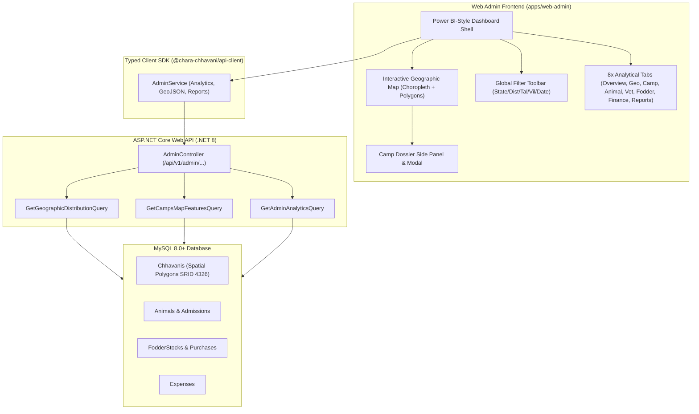

# Understanding Document: Admin Dashboard CR v2.0 (Geographic Intelligence & Power BI Analytics)

**Module / Task:** Change Request (CR) Implementation for Chara Chhavani Admin Dashboard Version 2.0  
**Document Version:** 2.0.0  
**Status:** Approved  
**Lifecycle Stage:** Stage 2 (Understanding)  
**Author:** Lead Enterprise Solutions Architect & QA SDET  

---

## 1. Business Context & Problem Statement

The State of Maharashtra administers disaster relief cattle camps (Chara Chhavanis) across drought-prone regions. In Phase 1, the Web Admin Dashboard provided basic summary counters, camps listings, and CSV exports.

**CR v2.0 Mandate**:
Transform the State Relief Administration Dashboard into an interactive, **Power BI-style spatial intelligence and multi-tier analytics platform**. The State Relief Commissioner and District Collectors require:
1. **Interactive Geographical Map Navigation**:
   - Hierarchical spatial drill-down: **State (Maharashtra) → District → Taluka → Village → Individual Camp**.
   - Chloropleth color grading based on:
     - Number of registered camps (Default: 0=Light Grey, 1-5=Very light blue, 6-10=Light blue, 11-20=Medium blue, 21-50=Dark blue, >50=Deep blue).
     - Admitted animals count.
     - Capacity utilization percentage.
   - Interactive hover tooltips showing district/taluka/village statistics.
   - Exact camp markers and actual saved geofence polygons (translucent fill, distinct outline, selection highlight, never approximate circles).
2. **Camp Selection Dossier Panel**:
   - Clicking any camp marker or polygon displays full operational details: Profile, Operator Contact, Capacity Utilization, Livestock Distribution, Dual-Source Fodder Balances, and Operational Expenses.
3. **Executive Overview with Global Filter Bar**:
   - State, District, Taluka, Village, Date Range, Camp Status filters with instant "Clear Filters" capability.
   - Primary & Secondary KPI cards with metric names, values, units, and period comparisons.
4. **Specialized Analytical Tabs**:
   - **Overview**: Map, primary/secondary KPIs, quick summary.
   - **Geographic Analytics**: Choropleth maps, administrative hierarchy tables.
   - **Camp Analytics**: Occupied vs available stacked bars, utilization alerts.
   - **Animal Analytics**: Livestock type distribution (Cow, Buffalo, Goat, Sheep), registration trends, admission vs release.
   - **Veterinary Verification**: Pending requests, approved/rejected ratios, doctor metrics.
   - **Fodder & Stock Analytics**: Dual-source Store vs In Farm balances, purchase vs consumption trends.
   - **Financial Analytics**: Fodder purchases vs Itemized Operational Expenses (Labour, Water, Electricity, Transportation, Other).
   - **Reports**: 15 report catalog with instant filtering, pagination, and RFC 4180 CSV export with UTF-8 BOM encoding.
5. **Backend Data Aggregation Mandate**:
   - The React frontend must never pull bulk transactional tables to calculate dashboard metrics.
   - The .NET backend must provide dedicated, optimized aggregation endpoints with server-side caching and spatial GeoJSON features.

---

## 2. Technical Stack & Architecture



---

## 3. API & Entity Contracts

### 3.1 Geographic Distribution API (`GET /api/v1/admin/geographic-distribution`)
* **Parameters**: `?district=...&taluka=...&metric=camps|animals|utilization`
* **Response**:
  ```json
  {
    "level": "State" | "District" | "Taluka" | "Village",
    "selectedArea": "Maharashtra",
    "metric": "camps",
    "items": [
      {
        "id": "CSN",
        "name": "Chhatrapati Sambhajinagar",
        "parent": "Maharashtra",
        "campCount": 12,
        "farmerCount": 1450,
        "animalCount": 4200,
        "admittedCattle": 3800,
        "totalCapacity": 5000,
        "utilizationPercentage": 76.0,
        "colorGrade": "Medium blue",
        "hasCamps": true
      }
    ]
  }
  ```

### 3.2 Camp Map Features API (`GET /api/v1/admin/camps-map`)
* **Parameters**: `?district=...&taluka=...&status=Active`
* **Response**: GeoJSON FeatureCollection containing `Point` markers and `Polygon` geofence boundaries with properties:
  - `campId`, `campCode`, `name`, `village`, `taluka`, `district`
  - `totalCapacity`, `admittedCattle`, `availableCapacity`, `utilizationPercentage`
  - `status`, `operatorName`, `operatorMobile`
  - `polygonCoordinates`: array of `[longitude, latitude]` points forming a closed ring.

### 3.3 Multi-Section Analytics API (`GET /api/v1/admin/analytics/{section}`)
* `section = camps`: Capacity breakdown by district/taluka, utilization rankings, threshold warnings ($> 90\%$).
* `section = animals`: Breakdown by Cow, Buffalo, Goat, Sheep; daily registration trend; admission vs release.
* `section = veterinary`: Verification requests, approval rate, rejection reasons, pending queue.
* `section = fodder`: Store vs In Farm stock balances, consumption rate (kg/animal/day), purchase volume.
* `section = financial`: Fodder purchase spend vs categorized operational expenses (Labour, Water, Electricity, Transportation, Other).

---

## 4. Non-Functional & UI/UX Requirements
1. **Interactive SVG / GeoJSON Rendering**: High-performance interactive vector rendering without requiring external API keys.
2. **Power BI-Style Visual Hierarchy**: Consistent color palette matching `@chara-chhavani/ui-core` (`#1B5E20` brand green, `#E65100` warm amber, `#0288D1` sky blue).
3. **Accessibility & Sunlight Readability**: WCAG 2.1 AA compliant contrast ratios for tablet and desktop field operations.
4. **Resilient Offline / Low-Latency State**: Loading skeletons, informative empty states, and local caching.
5. **Zero Lint & Typecheck Errors**: Enforced by strict 13-stage lifecycle governance.
