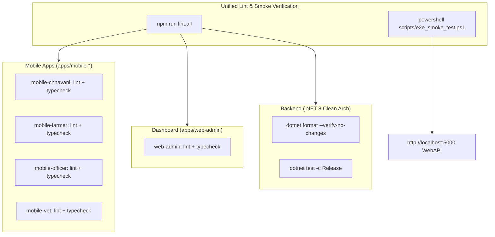

# Understanding Document: E2E Smoke Test Fix & Multi-Tier Lint Rules (Apps, Dashboard, Backend)

**Module / Task:** Fix `scripts/e2e_smoke_test.ps1` and Establish Granular Lint Rules Across All Mobile Apps, Web Admin Dashboard & Backend  
**Document Version:** 1.0.0  
**Status:** Approved  
**Lifecycle Stage:** Stage 2 (Understanding)  
**Author:** Lead Enterprise Solutions Architect & QA SDET  

---

## 1. Business Context & Problem Statement

1. **`scripts/e2e_smoke_test.ps1` Robustness & Error Remediation:**
   * In `scripts/e2e_smoke_test.ps1`, the API client helper (`Invoke-Api`) and test assertions contained potential unhandled terminating exceptions:
     - Unsafe property access (`$health.data.service`, `$otpVerify.data.token`, `$camps.data.Count`) when an HTTP request fails or returns `$null` while `$ErrorActionPreference = "Stop"`.
     - `Invoke-RestMethod` lacked `-UseBasicParsing` and detailed error stream extraction from `WebException` responses, obscuring HTTP 400/500 backend diagnostics.
     - Encoding / line ending inconsistencies that trigger editor syntax warnings in IDE environments.
2. **Granular Linting Across All Layers:**
   * While root `eslint.config.mjs` was established, individual workspace sub-packages lacked local linting definitions:
     - Mobile Apps (`apps/mobile-chhavani`, `apps/mobile-farmer`, `apps/mobile-officer`, `apps/mobile-vet`) had no `"lint"` and `"typecheck"` scripts.
     - Web Admin Dashboard (`apps/web-admin`) had no `"lint"` and `"typecheck"` scripts.
     - Backend had no npm-callable lint command to trigger Roslyn analyzer checks and `dotnet format`.
   * Standard software engineering governance requires every module to be independently lintable and verifiable via `npm run lint` both locally within each package and centrally from root.

---

## 2. Functional & Technical Requirements

### 2.1 `scripts/e2e_smoke_test.ps1` Error Fix
* Refactor `Invoke-Api`:
  - Add `-UseBasicParsing` to `Invoke-RestMethod` for universal Windows PowerShell 5.1 / PowerShell Core compatibility.
  - Safely handle JSON payloads whether passed as hashtables or pre-formatted JSON strings.
  - Implement full error stream reading on `WebException` to capture backend validation error arrays (`$_.Exception.Response.GetResponseStream()`).
  - Add null-safe property coalescing across all assertions so failures are clearly marked as `[FAIL]` rather than abruptly crashing PowerShell with unhandled null pointer exceptions.
  - Normalize line endings to Windows CRLF.

### 2.2 Granular Multi-Tier Lint Rules
* **Mobile Apps (All 4 Apps):**
  - Add `"lint": "eslint src"` and `"typecheck": "tsc --noEmit"` to `package.json` for:
    - `@chara-chhavani/mobile-chhavani`
    - `@chara-chhavani/mobile-farmer`
    - `@chara-chhavani/mobile-officer`
    - `@chara-chhavani/mobile-vet`
* **Web Admin Dashboard:**
  - Add `"lint": "eslint src"` and `"typecheck": "tsc --noEmit"` to `apps/web-admin/package.json`.
* **Shared Libraries:**
  - Add `"lint": "eslint src"` and `"typecheck": "tsc --noEmit"` to `packages/api-client/package.json` and `packages/ui-core/package.json`.
* **Backend C#:**
  - Configure root npm script `"lint:backend": "dotnet format backend/CharaChhavani.sln --verify-no-changes"`.
  - Maintain [.editorconfig](file:///c:/Users/Shubham/Downloads/0_myDisk/Personal-Projects/Chara-Chhavani/.editorconfig) rules.
* **Unified Workspace Commands:**
  - `npm run lint:apps`: Lints all 4 mobile apps.
  - `npm run lint:dashboard`: Lints web admin dashboard.
  - `npm run lint:backend`: Verifies backend C# formatting and analyzers.
  - `npm run lint:all` (or `npm run lint`): Executes linting across every tier with zero errors permitted.

---

## 3. Data Flow & Execution Verification

