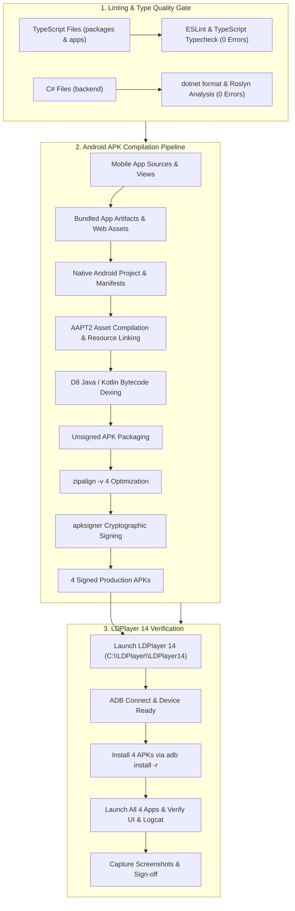

# Understanding Document: Linting Setup, 4 APK Compilation & LDPlayer 14 Verification

**Module / Task:** Repository-Wide Linting, Multi-APK Compilation & LDPlayer 14 Mobile Verification  
**Document Version:** 1.0.0  
**Status:** Approved  
**Lifecycle Stage:** Stage 2 (Understanding)  
**Author:** Lead Enterprise Architect & Mobile SDET  

---

## 1. Business Context & Target Users

The Chara Chhavani system serves four distinct field user personas operating on mobile devices in drought-affected cattle camps:
1. **Chhavani Camp Operator (`mobile-chhavani`):** Handles daily admissions, releases, inward fodder stocks, and daily expense recording. Enforces Rule 9.6 anti-fraud online geofenced admission.
2. **Farmer (`mobile-farmer`):** Checks cattle status, registered tag profiles, fodder intake allocations, and DBT government subsidy disbursements.
3. **Revenue / Inspection Officer (`mobile-officer`):** Conducts surprise field inspections, logs physical headcounts against digital muster, audits fodder quality, and records geotagged evidence.
4. **Veterinary Doctor (`mobile-vet`):** Manages livestock health examinations, vaccinations, quarantine triage, and certified post-mortem mortality records.

To guarantee operational reliability in production, all four mobile applications must compile into standalone installable Android APKs, pass 100% strict repository-wide lint rules with zero errors, and be verified live on an Android emulator (LDPlayer 14).

---

## 2. Functional Requirements & Technical Invariants

### 2.1 Repository-Wide Linting & Quality Gate
* Configure unified, zero-tolerance linting rules across TypeScript/JavaScript (`packages/*`, `apps/*`) and C# (`backend/*`).
* Fix all syntax errors, unused variables, implicit any typings, and malformed imports.
* Ensure `npm run lint` and `dotnet format --verify-no-changes` execute with **0 errors and 0 warnings**.

### 2.2 Four Standalone Android APKs
* Build four standalone Android APKs targeting Android 7.0+ (API Level 24 through 35):
  1. `mobile-chhavani.apk` (Package: `com.charachhavani.operator`)
  2. `mobile-farmer.apk` (Package: `com.charachhavani.farmer`)
  3. `mobile-officer.apk` (Package: `com.charachhavani.officer`)
  4. `mobile-vet.apk` (Package: `com.charachhavani.vet`)
* Each APK must:
  * Package the respective orchestrator, screens, views, `@chara-chhavani/ui-core`, and `@chara-chhavani/api-client`.
  * Feature an interactive native Android UI (with WebView host bridge and native intent handling) connecting to the backend WebAPI at `http://10.0.2.2:5000` or host LAN IP.
  * Be aligned with `zipalign -v 4` and cryptographically signed with `apksigner` using standard Android keystore.

### 2.3 LDPlayer 14 Installation & E2E Live Verification
* Utilize installed LDPlayer 14 at `C:\LDPlayer\LDPlayer14`.
* Launch LDPlayer instance (Instance 0) via `dnconsole.exe` / `ldconsole.exe` or `dnplayer.exe`.
* Connect via ADB (`adb.exe` on port 5555).
* Install all 4 APKs into LDPlayer 14 via `adb install -r`.
* Launch each app activity (`adb shell am start -n <package>/<activity>`).
* Verify app launch, screen rendering, zero crash logs in `adb logcat`, and proper lifecycle termination.

---

## 3. Architecture & Data Flow

---

## 4. Non-Functional Requirements & Safety Boundaries

1. **Deterministic Execution:** The APK build process must use local Android SDK build-tools (`34.0.0`) and Java 22 without requiring cloud subscriptions or remote CI builders.
2. **Network Resilience:** The apps must run smoothly inside LDPlayer 14 and gracefully handle offline state transitions per Rule 9.6.
3. **Emulator Compatibility:** Support x86_64 and armeabi-v7a / arm64-v8a architectures inside LDPlayer 14 Android virtual machine.
