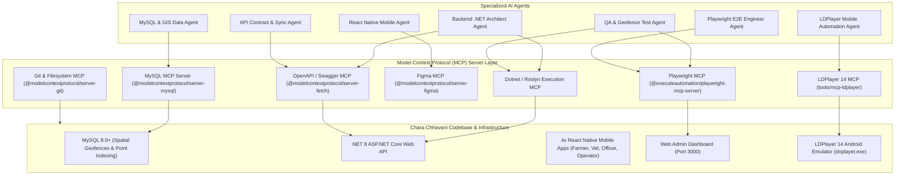

# Understanding Document: MCP Ecosystem & Specialized AI Agents Architecture

**Module / Task:** Implementation and Specification of Model Context Protocol (MCP) Servers, Specialized AI Agents, and Playwright Test Automation  
**Document Version:** 1.0.0  
**Status:** Approved  
**Lifecycle Stage:** Stage 2 (Understanding)  
**Author:** Lead Enterprise Solutions Architect & QA SDET  

---

## 1. Business & Technical Context

The **Chara Chhavani (Cattle Camp) Management System** is a mission-critical state government disaster management and relief distribution platform. Because the solution spans multiple disparate tiers:
1. **Database & GIS Layer**: MySQL 8.0+ with spatial polygon boundaries (`NetTopologySuite`, `ST_Contains`, `SPATIAL INDEX`).
2. **Backend Services Layer**: ASP.NET Core (.NET 8/9 Clean Architecture, MediatR, FluentValidation, JWT, EF Core).
3. **API Contract Bridge**: OpenAPI/Swagger v1 specs driving typed TypeScript client generation.
4. **Mobile Applications Layer**: 4 independent React Native / Android applications (`Farmer`, `Vet`, `Officer`, `Chhavani Operator`).
5. **Web Admin Dashboard Layer**: State Executive Relief Administration Dashboard with live KPI counters, district breakdowns, and geofence inspections.
6. **Mobile Hardware Emulator & Automated E2E**: LDPlayer 14 Android emulator and Playwright browser automation for web dashboard validation.

To operate at enterprise velocity while maintaining strict zero-regression quality, the system requires a structured **Model Context Protocol (MCP)** server network and a team of **Specialized Domain AI Agents** rather than a single monolithic assistant.

---

## 2. Model Context Protocol (MCP) Architecture

MCP servers act as standardized bridges granting AI agents real-time, deterministic tool execution across the Chara Chhavani repository, databases, emulators, and browsers.

---

## 3. Server-by-Server Functional Mandates

### 3.1 Database: MySQL MCP Server (`@modelcontextprotocol/server-mysql`)
* **Role**: Schema introspection, SQL query execution, explain plan analysis, and spatial index validation.
* **Chara Chhavani Utility**: Verifies that table columns like `PolygonGeofence` are indexed with `SPATIAL INDEX` and validates spatial geometry records.

### 3.2 Backend: Dotnet / Roslyn Execution MCP
* **Role**: Build execution, EF Core migration generation, unit test runner, Roslyn code analyzer inspection.
* **Chara Chhavani Utility**: Automates `dotnet ef migrations add`, runs `dotnet test backend/CharaChhavani.sln`, and enforces clean architecture boundaries.

### 3.3 Contract: OpenAPI / Swagger MCP (`@modelcontextprotocol/server-fetch`)
* **Role**: Fetches live API contracts from `/swagger/v1/swagger.json` or `/api/v1/health`.
* **Chara Chhavani Utility**: Ensures zero drift between C# DTOs and `@chara-chhavani/api-client`.

### 3.4 Design: Figma MCP (`@modelcontextprotocol/server-figma`)
* **Role**: Extracts design tokens, color constants, layout specs, and SVG assets.
* **Chara Chhavani Utility**: Directly aligns `@chara-chhavani/ui-core` design tokens (e.g. `Colors.primary = #1B5E20`) with Figma government relief design systems.

### 3.5 Infrastructure: Git & Filesystem MCP (`@modelcontextprotocol/server-git`)
* **Role**: Version control management, branch isolation, and monorepo file tracking.

### 3.6 Web E2E: Playwright MCP & Agent
* **Role**: Headless and headed browser automation driving Chromium, Firefox, and WebKit.
* **Chara Chhavani Utility**: Validates the Web Admin Dashboard (`http://localhost:3000`) for KPI counters, district tables, and geofence management.

### 3.7 Mobile Hardware: LDPlayer 14 MCP (`tools/mcp-ldplayer`)
* **Role**: Physical/emulator Android control via ADB and `ldconsole`.
* **Chara Chhavani Utility**: Installs and launches the 4 compiled APKs (`mobile-farmer.apk`, `mobile-vet.apk`, `mobile-officer.apk`, `mobile-chhavani.apk`), simulates GPS coordinates (`c.set_gps('LDPlayer', 75.3341, 19.8214)`), and validates admission geofencing.

---

## 4. Specialized AI Agents Taxonomy

1. `dotnet-backend-architect`: Clean Architecture, MediatR CQRS, NetTopologySuite GIS spatial methods, JWT auth.
2. `react-native-mobile-engineer`: React Native UI, offline-first sync, camera, and location stamping.
3. `mysql-data-architect`: MySQL 8.0 spatial indexing, relational schema normalization, EF Core migrations.
4. `api-contract-sync-agent`: Fullstack bridge syncing OpenAPI contracts to TypeScript interfaces.
5. `qa-geofence-tester`: Cross-tier geofence validation, point-in-polygon verification, boundary edge cases.
6. `playwright-e2e-engineer`: Automated browser testing for state administration dashboards and reports.
7. `ldplayer-mobile-automation-agent`: Real-time Android emulator automation, APK deployment, GPS mocking.
8. `devops-release-agent`: Production readiness, cryptographic APK signing, lint orchestration, CI/CD.

---

## 5. Non-Functional Requirements (NFR)
* **Zero Discrepancy**: All MCP configurations must be syntactically valid JSON.
* **Local Determinism**: All Playwright tests must run locally against `http://localhost:3000`.
* **Clean Code**: Zero lint or TypeScript errors across the repository (`npm run lint:all`).
